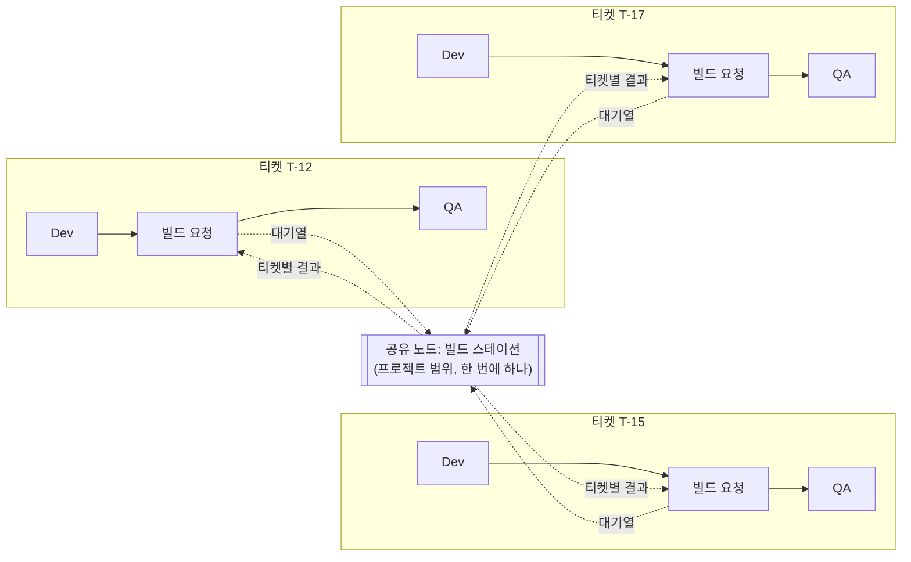
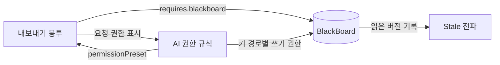

# 공유 · AI 권한 · BlackBoard 설계

> 세 가지 모두 PRD의 대원칙 **"항상 커스텀할 수 있게 만든다"** 에서 나온다.
> - 만든 것을 남에게 쉽게 넘길 수 있어야 한다 → **가져오기/내보내기**
> - AI가 툴을 다룰 수 있는 범위도 사용자가 정해야 한다 → **AI 권한 정책**
> - 여러 워크플로가 같은 자료를 봐야 할 때가 있다 → **BlackBoard**
>
> 노드 간 인계 규격과 노드·스키마 커스텀은 [[n8n 노드 데이터 전달 분석]] §6에 있다. 이 문서는 그 위에 얹는다.

## 0. 요약

- **가져오기/내보내기:** 노드 타입, 워크플로 템플릿, 스키마, 권한 프리셋, BlackBoard 정의를 **같은 JSON 봉투**로 내보내고 가져온다. 템플릿을 내보내면 그 템플릿이 쓰는 선언형 노드 타입이 함께 묶인다. 비밀값은 절대 들어가지 않는다. 캔버스에서 노드를 복사하면 클립보드에 JSON이 담겨서 메신저로도 공유할 수 있다.
- **AI 권한:** Vuyro의 모든 동작은 같은 명령 API를 거친다. 그래서 **명령 하나하나를 허용(allow) · 확인(ask) · 거부(deny)로 정하는 규칙**으로 권한을 표현한다. 규칙은 누가(패널 에이전트, 노드 에이전트, 외부 MCP), 어디서(앱, 프로젝트, 템플릿, 티켓)마다 따로 정한다. PRD의 "권한 3단계"는 이 규칙을 미리 묶어 둔 프리셋이 된다.
- **BlackBoard:** 만드는 것을 추천한다. 단, **"공용 폴더"가 아니라 "버전이 있고 누가 읽었는지 기록되는 공용 게시판"** 으로 만들어야 한다. 그래야 BlackBoard 값이 바뀌었을 때 그 값을 읽은 티켓에 Stale을 전파할 수 있다. 이게 n8n Variables나 Data Tables와 다른 점이다.

## 1. 가져오기 / 내보내기

### 1.1 대상

| 종류(`kind`) | 내용 | 예 |
|---|---|---|
| `nodeType` | 선언형 노드 타입 하나(`NodeTypeSpec` + 프롬프트 템플릿 / 명령) | "스펙 리뷰 에이전트" |
| `template` | 워크플로 템플릿 하나(노드 인스턴스, 연결, 포트 스키마 확장) | "AI-Native SDLC" |
| `bundle` | 템플릿 + 그 템플릿이 쓰는 선언형 노드 타입 전부 | 팀에 템플릿을 통째로 넘길 때 |
| `schema` | 스키마 하나 | QA 결과 스키마 |
| `permissionPreset` | AI 권한 규칙 묶음(§2) | "우리 팀 기본 권한" |
| `blackboardSpec` | BlackBoard 항목 정의와 선택한 값(§3) | 프로젝트 공용 링크 모음 |
| `nodes` | 캔버스에서 복사한 노드 몇 개와 그 사이 연결 | 메신저로 붙여넣기 |

### 1.2 봉투 형식

```jsonc
{
  "vuyro": "export",
  "formatVersion": 1,
  "kind": "bundle",
  "id": "myteam/ai-sdlc",          // 네임스페이스/이름. 전역에서 겹치지 않게
  "version": 3,
  "name": "AI-Native SDLC (우리 팀)",
  "description": "...",
  "author": "...",
  "requires": {                      // 가져오는 쪽에 있어야 하는 것
    "vuyro": ">=0.3",
    "nodeTypes": { "vuyro.agent": 1, "vuyro.approval": 1 },
    "plugins": { "p4": "^1.0" },     // 코드형 플러그인은 묶지 않고 이름만
    "artifactKinds": ["confluence", "p4"],
    "blackboard": ["project:styleGuide"],
    "credentials": ["confluence-main"]   // 이름만. 값은 절대 없음
  },
  "content": { /* kind에 맞는 본문 */ },
  "embedded": [ /* bundle일 때 함께 묶인 nodeType 봉투들 */ ],
  "checksum": "sha256:..."
}
```

- **비밀값은 들어가지 않는다.** 자격증명은 이름으로만 가리키고, 가져올 때 가져오는 사람의 자격증명과 연결한다(n8n도 같은 방식).
- **코드형 플러그인은 묶지 않는다.** 실행 코드라서 따로 설치하고 신뢰를 확인받아야 한다. 봉투에는 필요하다는 사실만 적는다.
- **실행 기록과 티켓은 내보내기 대상이 아니다.** 나중에 버그 리포트용 "티켓 내보내기"가 필요하면 별도 `kind`로 추가한다.

### 1.3 가져오기 흐름

1. **미리보기:** 무엇이 들어 있는지, 없는 의존성이 무엇인지 보여준다. 특히 **실행되는 것**(스크립트 노드의 명령, 에이전트 프롬프트)과 **요청하는 AI 권한**을 따로 표시한다.
2. **연결:** 자격증명 이름, BlackBoard 항목, 산출물 kind를 내 환경의 것과 짝짓는다.
3. **충돌 처리:**
   - 같은 `id`의 새 `version` → 새 버전으로 추가. 기존 버전과 그걸 쓰는 티켓은 그대로 둔다.
   - 같은 `id`, 같은 `version`인데 내용(checksum)이 다르면 → 거부하고 다른 네임스페이스로 가져올지 묻는다.
4. **저장:** 가져온 것도 내가 만든 것과 똑같이 고칠 수 있다(인계 규격 문서 §6.7 커스텀 원칙).

### 1.4 정본 형식에 대한 제안

PRD의 열린 질문 "워크플로 정본 형식: 텍스트 파일 vs 앱 내부 DB"에 대한 제안이다.

- **추천: 템플릿, 노드 타입, 스키마, 권한 프리셋은 처음부터 위 봉투 형식의 JSON 파일로 저장한다.** 실행 상태와 이벤트 로그만 DB에 둔다.
- 이렇게 하면 내보내기는 파일 복사가 되고, git이나 Perforce에 올려서 팀이 함께 관리할 수 있다.

## 2. AI 권한 정책

### 2.1 원리: 명령이 권한의 단위다

PRD 설계 원칙에 따라 UI 버튼, `vuyro` CLI, 에이전트 패널, MCP가 모두 같은 명령 API를 쓴다. 그래서 **권한 = "누가, 어디서, 어떤 명령을 할 수 있나"** 로 정리된다. 화면에서 할 수 있는 모든 동작에 명령 이름이 있으므로, 모든 동작을 옵션으로 만들 수 있다.

### 2.2 누가 (주체)

| 주체 | 설명 | 기본 성향 |
|---|---|---|
| `panel.app` | 앱 전체 범위 에이전트 패널 | 넓게 읽고, 쓰기는 확인 |
| `panel.ticket` | 티켓 범위 에이전트 패널 | 그 티켓 안에서만 |
| `node.agent` | 워크플로 노드로 실행 중인 에이전트 | **자기 노드만**(자기 산출물 등록, 자기 노드 완료) |
| `mcp.external` | 외부에서 Vuyro MCP 서버로 붙은 클라이언트 | 기본 읽기 전용 |

### 2.3 무엇을 (명령 목록 예시)

| 묶음 | 명령 |
|---|---|
| 읽기 | `ticket.read`, `template.read`, `run.read`(로그·비용), `blackboard.read`, `settings.read` |
| 티켓 | `ticket.create`, `ticket.update`, `ticket.cancel`, `ticket.delete` |
| 진행 | `node.start`, `node.done`, `node.approve`, `node.reject`, `node.reopen`(CR), `stale.confirm` |
| 편집 | `template.edit`, `nodeType.create`, `nodeType.edit`, `schema.edit` |
| 산출물 | `artifact.add`, `artifact.fetch` |
| BlackBoard | `blackboard.write`, `blackboard.delete` (키 경로로 범위 지정) |
| 공유 | `export`, `import` |
| 실행·비용 | `agent.run`(비용 발생), `script.run`(외부 부작용) |
| 설정 | `settings.edit`, `plugin.install`, `permission.edit` |

### 2.4 규칙

```jsonc
{
  "subject": "panel.ticket",
  "scope": "project:sample",        // app | project | template | ticket | node
  "action": "node.approve",          // 와일드카드 가능: "template.*"
  "target": "*",                     // 키 경로나 노드 id 등. 예: "blackboard:project/design/*"
  "effect": "ask",                   // allow | ask | deny
  "when": { "maxCostUsd": 2 }        // 선택. 비용 상한 등 조건
}
```

- **판정 순서:** deny가 하나라도 맞으면 거부 → ask가 맞으면 확인 → allow가 맞으면 허용 → 아무것도 안 맞으면 ask. (Claude Code 권한 규칙과 같은 순서)
- **층:** 앱 기본 → 프로젝트 → 템플릿(노드 인스턴스마다 다르게 줄 수 있음) → 티켓.
  - 아래 층이 위 층의 allow나 ask는 바꿀 수 있지만, **위 층의 deny는 풀 수 없다.** 팀 관리자가 막아 둔 것을 개인 설정으로 여는 것을 막기 위해서다.
- **ask는 결정 인박스로 간다.** 버튼은 "이번만 허용", "항상 허용(규칙 저장)", "거부" 세 가지다. "항상 허용"을 누르면 위 형식의 규칙이 저장된다(PRD의 "규칙 저장").
- **모든 AI 동작은 작업 기록에 남는다.** 어떤 주체가 했는지, 어느 규칙에 맞았는지까지 함께 남긴다.

### 2.5 프리셋 (PRD "권한 3단계"를 대체)

| 프리셋 | 내용 |
|---|---|
| 읽기 전용 | 읽기만 allow, 나머지 deny |
| 제안 | 읽기 allow, 모든 쓰기 ask |
| 협업 (기본) | 되돌릴 수 있는 쓰기(편집, 티켓 생성, BlackBoard 쓰기)는 allow. 사람 게이트 승인·반려, 삭제, `agent.run` 비용 상한 초과, `script.run`, `import`, `plugin.install`은 ask |
| 자동 | 대부분 allow(사람 게이트 대리 승인 포함, §2.8). `permission.edit`만 deny |

프리셋은 출발점이다. 고르고 나서 규칙을 하나씩 바꿀 수 있고, 바꾼 것을 `permissionPreset`으로 내보내 팀과 공유한다.

### 2.6 고정 규칙 하나: AI는 자기 권한을 올릴 수 없다

- 모든 것을 옵션으로 두더라도 **`permission.edit`은 AI 주체에게 항상 deny로 고정하는 것을 추천한다.**
- 이게 열려 있으면 AI가 스스로 규칙을 바꿔 다른 옵션을 전부 무력화할 수 있기 때문이다.
- AI는 권한 변경을 **제안**할 수 있다. 결정 인박스에 "이 규칙을 추가할까요?" 카드를 만들고, 적용은 사람이 한다.

### 2.7 Vuyro 권한과 에이전트 CLI 권한은 다른 층이다

- 이 문서의 권한은 **Vuyro 툴을 조작하는 권한**이다.
- 에이전트가 파일을 고치거나 셸을 실행하는 권한은 Claude CLI와 Codex CLI 자체의 설정(허용 도구, 샌드박스)이 맡는다.
- Vuyro는 노드의 `attachments`로 그 설정을 넘겨준다. 화면에서는 두 층을 한곳에 보여준다.

### 2.8 AI 대리 승인 (결정 2026-10-23)

> **결정:** 사람 게이트의 승인·반려도 AI에게 맡길 수 있게 옵션으로 연다.

- **별도 기능이 아니라 일반 권한 규칙이다.** `node.approve`, `node.reject`를 AI 주체에게 allow로 주면 된다.
  - 협업 프리셋(기본)에서는 ask이고, 자동 프리셋에서는 allow다.
- **위임 범위를 좁힐 수 있다.**
  - 게이트 노드마다 다르게 줄 수 있다(`target`에 노드 id). 예: "Spec 승인은 사람만, 코드 리뷰 승인은 AI도 가능".
  - 조건(`when`)을 붙일 수 있다. 예: QA 결과가 통과일 때만, 변경 파일 수 N개 이하, 비용 상한 이하.
- **자기 결과 승인은 기본으로 끈다.** 같은 노드 실행에서 만든 산출물을 그 에이전트가 스스로 승인하는 것은 `selfApproval: false`가 기본이다. 이것도 옵션이라 켤 수 있다.
- **AI 승인은 사람 승인과 구분해서 남긴다.**
  - 작업 기록과 화면에 "AI 승인" 배지를 붙이고, 승인한 주체, 맞은 규칙, 근거(summary)를 함께 남긴다.
  - 통계에서도 사람 대기 시간과 AI 승인을 따로 센다.
  - 사람은 나중에 AI 승인을 되돌릴 수 있다. 되돌리면 변경 요청(CR)과 같은 경로로 게이트를 다시 열고 하위 노드를 Stale로 표시한다.

## 3. BlackBoard

### 3.1 만들 만한가: 추천한다, 조건 세 가지와 함께

필요한 상황은 분명하다.

- 여러 템플릿이 같은 기획 규칙 문서를 참고한다.
- 아트 리소스 폴더, p4 스트림 경로, 용어집처럼 프로젝트 전체가 공유하는 위치가 있다.
- 병렬로 도는 티켓 둘이 같은 파일을 동시에 고치지 않도록 서로 알려야 한다.

이름도 잘 맞는다. 여러 에이전트가 공용 지식판에 읽고 쓰며 협업하는 구조를 멀티 에이전트 분야에서 실제로 **Blackboard architecture**라고 부른다.

다만 아무 데서나 읽고 쓰는 공용 폴더가 되면 Vuyro의 장점이 깨진다. 그래서 조건 세 가지를 둔다.

1. **누가 무엇을 읽었는지 기록한다.** 그래야 값이 바뀌었을 때 Stale을 전파할 수 있다. 기록되지 않는 공용 데이터는 "어디를 다시 해야 하는지 툴이 알려준다"는 차별점을 무너뜨린다.
2. **노드 간 전달을 대신하지 않는다.** 한 티켓 안에서 앞 노드가 뒤 노드에 넘기는 것은 인계 봉투로 한다. BlackBoard는 여러 워크플로나 여러 티켓이 공유하는 것만 담는다.
3. **버전과 권한이 있다.** 쓸 때마다 새 버전이 생기고, 키 경로마다 AI 권한 규칙(§2)을 건다.

### 3.2 비슷한 것들과 비교

| | 범위 | 쓰기 | 버전 | 읽은 기록 |
|---|---|---|---|---|
| n8n Variables (`$vars`) | 인스턴스 전체 | 워크플로에서는 읽기만 | 없음 | 없음 |
| n8n Data Tables | 프로젝트 | 노드로 행 추가·수정·삭제 | 없음 | 없음 |
| n8n workflow static data | 워크플로 하나 | 그 워크플로만 | 없음 | 없음 |
| Archon `$STATE_DIR` | 여러 run이 공유하는 폴더 | 자유 | 없음 | 없음 |
| **Vuyro BlackBoard** | 앱 / 프로젝트 | 권한 규칙대로 | **항목마다** | **있음 → Stale** |

### 3.3 항목 종류

| 종류 | 내용 | 예 |
|---|---|---|
| `value` | JSON 값. 스키마를 붙일 수 있음(인계 규격 문서 §6.7 방식) | 용어집, 코딩 규칙 요약, 마일스톤 날짜 |
| `ref` | `ArtifactRef`(폴더, 링크, 문서, p4 경로). 인계 봉투와 같은 형식이라 kind 플러그인과 가져오기 노드를 그대로 쓴다 | 기획 규칙 Confluence 페이지, 아트 리소스 폴더 |
| `claim` | 점유 표시: "티켓 X가 이 경로를 고치는 중". 티켓이 끝나면 자동 해제 | 병렬 티켓끼리 같은 파일 충돌 방지 |
| `table` (나중) | 행 목록. n8n Data Tables와 비슷 | 공용 작업 목록, 리소스 목록 |

비밀값은 BlackBoard에 넣지 않는다. 자격증명은 따로 관리한다.

### 3.4 범위와 키 (결정 2026-10-23)

> **결정:** MVP는 **내 로컬에서만 도는 앱**이다. BlackBoard도 로컬 앱 하나 안에서만 공유한다. 팀 협업과 여러 앱 연동은 MVP 이후에 한다.

- 범위는 **앱 전체**(이 로컬 앱)와 **프로젝트** 두 가지다. 키는 `project:design/styleGuide`, `app:glossary` 같은 경로 형식이다.
- 티켓 범위는 인계 봉투로 충분하므로 처음에는 두지 않는다.
- **나중에 팀 동기화를 붙이기 쉽게 하려고 지금 지켜 둘 것:**
  - 항목 id는 전역에서 겹치지 않게(UUID) 만든다.
  - 버전마다 쓴 주체와 시각을 남긴다.
  - 변경은 이벤트로 기록한다(PRD 설계 원칙과 같음).
  - 이 세 가지가 있으면 나중에 여러 앱의 변경을 합칠 수 있다.

### 3.5 읽고 쓰는 방법

모두 같은 명령 API를 거친다.

| 경로 | 예 |
|---|---|
| 노드 파라미터와 프롬프트 참조 | `{{ bb.project.design.styleGuide }}` |
| CLI(노드 에이전트) | `vuyro bb get project:design/styleGuide`, `vuyro bb set ... --expect-version 4` |
| 에이전트 패널, MCP | 같은 명령 |
| 전용 노드 | "BlackBoard 읽기 / 쓰기" 선언형 기본 노드 |

- **노드 타입과 템플릿은 읽고 쓰는 키를 선언한다** (`reads: [...]`, `writes: [...]`). 이 선언은 세 곳에 쓰인다.
  - 그래프에 "이 템플릿은 `styleGuide`를 읽음"으로 표시한다.
  - 내보내기 봉투의 `requires.blackboard`가 된다.
  - 권한 판정에 쓴다.
- 선언하지 않은 키를 실행 중에 읽어도 막지는 않는다. 다만 "선언되지 않은 읽기"로 표시해서 템플릿에 반영하게 한다(인계 규격 문서 §6.7과 같은 방식).

### 3.6 버전, 충돌, Stale

- **쓸 때마다 새 버전**이 생기고, 쓴 주체(사람 / 패널 에이전트 / 노드 실행 id)가 기록된다. 이력 화면에서 비교하고 되돌릴 수 있다.
- **동시 쓰기:** `--expect-version`으로 내가 읽은 버전일 때만 쓴다. 다르면 거부되고, 에이전트는 다시 읽고 고친다.
- **Stale:** 노드 실행이 읽은 BlackBoard 항목의 버전을 "읽은 것 기록"에 남긴다. 항목이 바뀌면 이전 버전을 읽은 진행 중 티켓의 노드가 Stale 후보가 되고, 사람이 확정한다.
  - 자주 바뀌는 값(진행 로그 등)은 항목마다 `staleOnChange: false`로 끌 수 있다.
  - 끝난 티켓은 기본적으로 대상에서 빼고, 옵션으로 포함한다.

### 3.7 claim 충돌 정책 (결정 2026-10-23)

> **결정:** 티켓끼리 작업이 겹칠 때 어느 쪽을 우선할지, 일시정지할지를 모두 옵션으로 둔다.

**claim의 모양**

```jsonc
{
  "key": "project:claims/Source/Game/UI/**",  // 경로 패턴
  "mode": "exclusive",       // exclusive(쓰기 독점) | shared(읽기 공유, 여러 티켓 가능)
  "owner": { "ticket": "T-12", "node": "dev#3" },
  "release": "nodeDone",     // nodeDone | ticketDone | manual
  "ttl": "2h"                // 앱이 죽어서 안 풀린 claim 정리용
}
```

- **언제 잡나:** 노드 타입이 `claims: [...]`로 미리 선언하면 노드가 시작할 때 한꺼번에 잡는다. 에이전트가 작업 중에 `vuyro bb claim`으로 추가로 잡을 수도 있다.

**충돌했을 때 (`onConflict`)**

| 정책 | 동작 |
|---|---|
| `firstWins` 먼저 진행 중인 티켓 우선 (기본) | 나중에 온 티켓의 노드가 **Paused**(claim 대기)로 들어간다. 점유가 풀리면 자동으로 재개한다 |
| `priorityWins` 우선순위 높은 티켓 우선 | 우선순위가 높은 티켓이 나중에 와도 낮은 티켓을 일시정지시키고 점유를 가져간다. 같으면 `firstWins` |
| `ask` 사람에게 묻기 | 결정 인박스에 "어느 티켓을 먼저 할까요?" 카드를 만든다. 답할 때까지 나중 티켓은 대기 |
| `warn` 경고만 | 둘 다 진행하고 양쪽에 겹침 경고를 표시한다 |
| `fail` 나중 티켓 실패 | 나중 티켓의 노드를 Failed로 끝낸다. 사람이 다시 시작한다 |

**일시정지 방법 (`pauseMode`)** — `priorityWins`처럼 이미 돌고 있는 노드를 멈춰야 할 때

| 방법 | 동작 |
|---|---|
| `boundary` 노드 경계에서 (기본) | 지금 노드는 끝까지 하고, 다음 노드로 넘어가지 않는다. 점유는 그때 넘긴다 |
| `immediate` 즉시 | 에이전트 프로세스를 멈추고 세션 id를 기록한다. 재개할 때 같은 세션을 이어서 시작한다. 작업 중이던 파일 변경이 남아 있다는 경고를 함께 표시한다 |

- **설정 층:** 앱 기본 → 프로젝트 → 템플릿 → claim 키별. 아래 층이 위 층을 덮어쓴다.
- **교착 상태:** A가 B를 기다리고 B가 A를 기다리면, 정책과 상관없이 결정 인박스로 보낸다.
- **보이게 하기:** 칸반과 관제실에서 Paused 노드에 "T-12의 `UI/**` 점유 대기"처럼 이유를 표시한다. 대기 시간은 관측 지표로 따로 센다.

### 3.8 내부 체크아웃 (결정 2026-10-23, MVP 포함)

> **구현(M4):** [[명령·이벤트 계약]] §14. 구현하며 정한 기본값은 [[결정 대기]] D-029~D-040.

> **결정:** Vuyro 안에 **체크아웃 개념**을 둔다. 목적은 **여러 노드가 같은 파일을 동시에 고치는 것을 막는 것**이다. MVP에 넣는다.
> - Perforce나 git의 실제 체크아웃을 거는 것이 아니다. Vuyro가 자기 장부에만 "이 파일은 지금 이 노드가 고치는 중"이라고 적는다.
> - 외부 툴(p4, git)은 건드리지 않는다. 그래서 저장소 종류와 상관없이 같은 방식으로 동작한다.

**막으려는 상황**

- 같은 티켓 안에서 병렬로 도는 Dev 노드 둘이 같은 파일을 고친다(`each` 팬아웃).
- 서로 다른 티켓의 노드 둘이 같은 파일을 고친다.
- 에이전트 패널의 AI가 실행 중인 노드가 고치는 파일을 건드린다.

**동작**

1. 노드(또는 패널 에이전트)가 파일을 고치기 직전에 `vuyro checkout <파일>`로 체크아웃한다.
2. 다른 노드가 이미 체크아웃한 파일이면 §3.7의 충돌 정책을 그대로 따른다(먼저 온 쪽 우선, 우선순위, 사람에게 묻기, 경고만, 실패). 막힌 쪽 노드는 Paused가 된다.
3. 노드가 끝나면 체크아웃을 해제한다(해제 시점은 옵션: 노드 완료 / 티켓 완료 / 수동).

**체크아웃 기록 (Vuyro 내부 장부)**

```jsonc
{
  "path": "Source/Game/UI/InventoryWidget.cpp",
  "ticket": "T-12", "node": "dev#3", "by": "node.agent",
  "mode": "exclusive",              // exclusive(혼자 고침) | shared(읽기만, 여럿 가능)
  "baseHash": "sha256:...",         // 체크아웃 시점의 파일 해시
  "pauseHash": "sha256:...",        // 일시정지 시점의 파일 해시(멈췄을 때만)
  "openedAt": "2026-10-23T14:02:00+09:00"
}
```

- 해시는 Vuyro가 직접 계산하는 SHA-256이다. 외부 툴의 버전 번호를 쓰지 않는다.
- `baseHash`로는 "체크아웃 이후 이 파일이 바뀌었는지"를 안다. 하지만 그 변경이 **자기 노드의 수정인지 남의 수정인지**는 알 수 없다. 그래서 일시정지할 때 `pauseHash`를 따로 찍는다. 재개할 때 `pauseHash`와 현재 해시를 비교하면 멈춘 동안 남이 바꾼 것만 골라낼 수 있다(Codex 검토에서 나온 보완).

**claim과의 관계**

| | claim | 체크아웃 |
|---|---|---|
| 언제 | 노드 시작 전, 미리 | 실제로 고치기 직전 |
| 단위 | 경로 패턴(`UI/**`) | 파일 하나 |
| 성격 | 넓은 예약 | 실제 편집 잠금 |

- 충돌 정책(`onConflict`, `pauseMode`)은 둘이 같은 것을 쓴다. 체크아웃끼리 겹쳐도, claim과 체크아웃이 겹쳐도 같은 표로 처리한다.
- claim 없이 체크아웃만 쓰는 템플릿도 가능하다.

**체크아웃을 빠뜨리지 않게 하는 장치** (에이전트가 깜빡하거나 셸로 고치는 경우)

1. **자동 체크아웃 훅 (옵션 `autoCheckoutHook`):** Claude CLI를 실행할 때 파일 수정 도구(Edit, Write 등) 직전에 도는 훅(PreToolUse)을 넣는다. 훅이 `vuyro checkout <파일>`을 대신 호출한다. 다른 노드가 잡고 있어서 충돌 정책이 막으라고 하면, 수정을 차단하고 이유를 에이전트에게 돌려준다.
   - Codex CLI에도 같은 훅이 있다(공식 문서 기준, 실제 차단 동작은 아직 미검증). `hooks.PreToolUse`에 `apply_patch`(Edit·Write 별칭)와 `Bash`를 걸 수 있고, deny 응답이나 종료 코드 2로 막는다. 프로젝트 훅은 Codex가 신뢰 확인을 요구한다.
   - **옵션이다.** 앱 → 프로젝트 → 템플릿 → 노드 순으로 켜고 끈다.
   - 기본값은 작업 공간 모드(§3.9)에 따라 다르다. 같은 폴더를 함께 쓰는 `shared` 모드에서는 켜고, `worktree` 모드에서는 끈다. worktree는 노드마다 폴더가 따로라서 디스크에서 파일이 겹치지 않기 때문이다.
2. **사후 검출:** 셸 명령(sed, 스크립트)으로 고친 파일은 훅을 피해 간다. 그래서 노드가 끝날 때(그리고 재개할 때) 바뀐 파일을 찾는다. 체크아웃 없이 바뀐 파일은 "체크아웃 없이 수정"으로 표시하고, 다른 노드가 잡고 있던 파일이면 충돌로 알린다.
   - Unreal 프로젝트 전체를 매번 해시할 수는 없다. 파일 감시 이벤트와 git status / `p4 opened` 같은 **읽기 전용 조회**로 바뀐 후보를 좁히고, 후보 파일만 해시한다. 크기·수정 시각은 다시 해시할지 정하는 힌트로만 쓴다.
   - 감시가 끊겼거나 앱이 꺼져 있던 동안의 변경은 대상 경로를 다시 조사하고, 누가 바꿨는지 모르면 "귀속 불명 변경"으로 표시한다.

**일시정지 후 재개 (§6 열린 질문 5의 답)**

- 재개할 때 그 노드가 체크아웃한 파일마다 `pauseHash`와 현재 해시를 비교한다. 달라졌으면 누가 바꿨는지(다른 노드의 체크아웃 기록)와 변경 요약을 만든다.
- 세션 재개는 "멈춘 도구 호출 지점부터 이어서"가 아니라 "같은 대화를 다음 턴으로 이어서"다. 그래서 재개 프롬프트에 멈출 때 무엇을 하고 있었는지와 파일 상태를 함께 넣는다.
- 이 요약을 재개 프롬프트에 "멈춘 동안 바뀐 것"으로 넣는다. 읽기만 한 파일이 바뀐 경우도 "읽은 것 기록"과 비교해서 함께 넣는다.
- 옵션으로, 바뀐 파일이 있으면 자동으로 재개하지 않고 사람 확인을 받는다.
- 재개하면 `pauseHash`를 지운다. `baseHash`는 그대로 둔다(노드 전체에서 이 파일이 얼마나 바뀌었는지 보는 기준).

**보이게 하기**

- 관제실에 "어느 노드가 어떤 파일을 체크아웃 중인지" 목록을 둔다.
- 그래프 캔버스에서 노드를 선택하면 그 노드가 잡고 있는 파일을 보여준다.

### 3.9 작업 공간 모드와 git worktree 병렬 처리 (결정 2026-10-23, MVP 포함)

> **구현(M4):** [[명령·이벤트 계약]] §14.6. 합류는 worktree 모드에서 엔진의 머지 단계로 돌고, 충돌 정책 `ask`의 승인·반려 뜻은 D-038이다.

> **결정:** 사용자가 원하면 **git worktree로 병렬 처리**를 지원한다. 노드나 티켓마다 별도 작업 폴더를 만들어서 파일이 디스크에서 겹치지 않게 한다. 쓸지 말지는 옵션이다.

**두 가지 모드 (`workspaceMode`)**

| 모드 | 동작 | 겹침을 막는 방법 | 맞는 경우 |
|---|---|---|---|
| `shared` (기본) | 모든 노드가 같은 작업 폴더에서 일한다 | 내부 체크아웃(§3.8), 자동 체크아웃 훅 켬 | git이 아닌 폴더, Perforce 작업 공간, 작은 작업 |
| `worktree` | 노드나 티켓마다 git worktree를 만들어 그 안에서 일한다 | 폴더가 달라서 편집 중에는 안 겹침. **겹침은 머지할 때 드러남** | git 저장소, 병렬 Dev가 많은 작업 |

- 설정 층은 앱 → 프로젝트 → 템플릿 → 노드다.
- `worktree`는 git 저장소일 때만 고를 수 있다. Archon처럼 **사용자가 명시적으로 켤 때만** 만들고, Vuyro가 알아서 추측해 켜지 않는다.
- worktree는 파일이 겹치는 것을 막아 줄 뿐, 보안 경계는 아니다(Archon도 같은 입장).

**worktree 단위 (`worktreeScope`)**

| 단위 | 동작 |
|---|---|
| `ticket` | 티켓 하나에 worktree 하나. 같은 티켓 안의 병렬 노드는 이 폴더를 함께 쓰므로, 그 안에서는 내부 체크아웃으로 막는다 |
| `nodeRun` | 노드 실행(팬아웃 아이템)마다 worktree 하나. 병렬 Dev 아이템이 각자 폴더를 가진다 |

- 브랜치 이름은 `vuyro/<티켓>/<노드>-<아이템>` 형식이다. 예: `vuyro/T-12/dev-3`. 형식은 바꿀 수 있다.
- 시작 기준점: `ticket` 단위는 티켓을 만들 때 고른 브랜치나 커밋에서 시작한다. `nodeRun` 단위는 티켓 브랜치의 현재 커밋에서 시작한다.
- 에이전트 CLI는 그 worktree 폴더를 작업 폴더로 삼아 실행한다.
- **준비 스크립트(옵션):** worktree를 만든 직후에 돌릴 명령을 지정한다. 예: 설정 파일 복사, 의존성 설치.

**합치기 (머지)**

- `nodeRun` 단위일 때는 **합류 노드가 아이템 브랜치들을 티켓 브랜치로 머지**한다. 인계 봉투의 `artifacts`에는 `kind: git`, 브랜치, 커밋이 담긴다.
- 머지 충돌이 나면 어떻게 할지 고른다(`onMergeConflict`):

| 정책 | 동작 |
|---|---|
| `ask` | 결정 인박스로 보낸다. 사람이 직접 풀거나 에이전트에게 맡긴다. 아무것도 고르지 않았을 때 이 정책을 쓴다 |
| `agent` | 충돌 해결 에이전트 노드를 자동으로 끼워 넣어 풀게 한다. 결과는 리뷰를 거친다 |
| `rerun` | 충돌난 아이템을 머지된 최신 커밋에서 다시 실행한다 |
| `fail` | 합류 노드를 Failed로 끝낸다 |

- **정책은 사용자가 고른다 (결정 2026-10-23).** `worktree` 모드를 켤 때 이 정책도 함께 고르게 하고, 설정 층(앱 → 프로젝트 → 템플릿 → 노드)마다 바꿀 수 있다.
- `agent`가 충돌을 풀지 못하면 `ask`로 넘어간다.

**미리 알려주기 (옵션 `overlapWarning`)**

- worktree 모드에서도 내부 체크아웃 장부에 "어느 worktree가 어떤 파일을 고쳤는지"는 기록한다. 이때는 막지 않고 기록만 한다.
- 두 worktree가 같은 파일을 고치면 "머지 충돌 가능성"을 미리 경고한다. 머지까지 기다리지 않고 일찍 알 수 있다.

**정리**

- 머지가 끝나거나 티켓이 끝나면 worktree를 지운다.
- 실패한 노드의 worktree는 확인할 수 있게 남겨 둔다(옵션). 남은 worktree 목록과 디스크 사용량을 관제실에 보여준다.

**주의: Unreal 같은 큰 프로젝트**

- worktree마다 빌드 결과물(Intermediate, Binaries 등)이 따로 생긴다. 그래서 빌드를 각각 다시 해야 하고 디스크도 많이 쓴다.
- 그런 프로젝트는 `ticket` 단위나 `shared` 모드가 현실적일 수 있다. 첫 사용 환경(Unreal + Perforce)에서는 `shared`가 기본이 될 가능성이 크다.
- 빌드 자체는 티켓마다 하지 않고, 여러 티켓을 모아 한 번에 한다(§4 공유 노드).

## 4. 공유 노드: 여러 티켓을 모아 한 번에 처리 (결정 2026-10-23)

> **결정:** Unreal처럼 큰 프로젝트는 티켓마다 따로 빌드할 수 없다. 그래서 **여러 티켓이 함께 쓰는 공유 노드**를 둔다. 각 티켓은 작업이 끝나면 공유 노드의 대기열에 들어가고, 공유 노드는 모인 티켓들을 **한 번에 처리**한 뒤 결과를 각 티켓에 돌려준다.

### 4.1 개념



- **공유 노드는 티켓 밖, 프로젝트 범위에 산다.** BlackBoard처럼 프로젝트에 하나 만들어 두고 여러 템플릿이 가리킨다. 실행 기록도 공유 노드가 따로 가진다.
- **템플릿에는 "요청 노드"를 둔다.** 요청 노드는 자기 티켓의 결과를 대기열에 넣고 기다린다. 공유 노드가 끝나면 그 티켓 몫의 결과를 받아 다음 노드로 넘긴다.
- **빌드 전용이 아니다.** 공유 노드 안에서 도는 것은 일반 노드 타입이다(스크립트, 에이전트, 묶음형 모두). 그래서 아래 작업에도 같은 구조를 쓴다.
  - 빌드
  - 쿠킹, 패키징
  - QA 서버 배포
  - 자동 테스트 한 바퀴
  - 일괄 submit
- 템플릿이 달라도 요청 노드의 포트 스키마만 맞으면 같은 공유 노드를 쓸 수 있다. 공유 노드 정의도 JSON으로 가져오고 내보낸다(§1, `kind: sharedNode`).

### 4.2 언제 실행하나 (`batchTrigger`)

| 조건 | 예 |
|---|---|
| `count` 대기열에 N개가 모이면 | 3개 모이면 빌드 |
| `window` 첫 요청 후 T분이 지나면 | 첫 요청 후 20분 |
| `schedule` 정해진 시각 | 매일 12:00, 18:00 |
| `afterPrevious` 앞 실행이 끝나면 쌓인 것 전부 | 빌드가 끝나자마자 다음 묶음 |
| `manual` 사람이 실행 | 관제실의 "지금 빌드" 버튼 |

- 조건은 여러 개를 함께 걸 수 있고, 먼저 만족하는 것으로 실행한다. 예: "3개 또는 20분 중 먼저".
- 우선순위가 높은 티켓이 들어오면 바로 실행하는 옵션(`expediteOnPriority`)을 둔다.
- 동시 실행 수는 `maxConcurrent`다. 빌드 머신이 하나면 1이다.

### 4.3 실행 중 작업 공간 보호

- `shared` 모드에서는 모든 티켓의 변경이 같은 폴더에 있다. 그래서 빌드 한 번에 대기 중인 티켓들의 변경이 모두 들어간다. 디스크를 더 쓰지 않는 방법이다.
- 대신 **빌드하는 동안 다른 노드가 소스를 고치면 빌드 결과를 믿을 수 없다.** 그래서 공유 노드는 실행하는 동안 지정한 경로(예: `Source/**`)에 **읽기 claim**을 건다(§3.7).
  - 그 경로를 고치려는 다른 노드는 충돌 정책에 따라 기다린다. 기본은 노드 경계에서 기다리기다.
  - 이 보호는 옵션이다. 끄면 빠르지만 빌드 결과가 흔들릴 수 있다.
- `worktree` 모드에서는 공유 노드가 먼저 대기 중인 티켓 브랜치들을 **통합 브랜치에 머지**하고 그걸 빌드한다. 머지 충돌은 §3.9의 `onMergeConflict`를 따른다.

### 4.4 결과를 티켓에 나눠 주기

- 공유 노드는 실행 한 번에 여러 티켓을 입력으로 받는다. 입력마다 "어느 티켓의 어느 노드에서 왔는지"를 기록한다(n8n `source`, 인계 봉투 `lineage`와 같은 개념).
- 끝나면 **티켓마다 따로 인계 봉투를 만들어** 각 요청 노드로 돌려준다.

```jsonc
{
  "port": "success",                // success | error | skipped
  "items": [{
    "data": {
      "batchId": "build-2026-10-23-07",
      "batch": ["T-12", "T-15", "T-17"],  // 함께 빌드한 티켓
      "errorsForThisTicket": []           // 이 티켓 탓으로 보이는 에러
    },
    "artifacts": { "log": { "kind": "file", "uri": ".../build-07.log" } },
    "summary": "3개 티켓 함께 빌드 성공 (14분)"
  }]
}
```

- **빌드 결과물(바이너리, 쿠킹 데이터)은 BlackBoard에 올리지 않는다 (결정 2026-10-23).** 결과물은 작업 공간에 그대로 두고, 인계 봉투에는 빌드 로그와 `batchId`만 담는다.

### 4.5 빌드가 깨졌을 때: 누구 탓인가 (`onBatchFailure`)

여러 티켓을 한 번에 빌드하면 실패했을 때 원인 티켓을 찾아야 한다. **내부 체크아웃 장부(§3.8)가 여기서 쓰인다.** 빌드 로그에 나온 파일 경로를 체크아웃 장부와 대조하면 그 파일을 고친 티켓을 알 수 있다.

| 정책 | 동작 |
|---|---|
| `blame` (기본) | 로그의 에러 파일을 체크아웃 장부와 대조해 원인 티켓을 추정한다. 원인 티켓은 `error` 포트로 보내고, **공유 노드는 원인 티켓이 고쳐질 때까지 멈춘다**(아래). 나머지 티켓은 대기열 맨 앞에 그대로 남는다. 원인을 못 찾으면 `ask`로 넘어간다 |
| `ask` | 결정 인박스로 보낸다. 추정 원인을 함께 보여준다 |
| `allFail` | 묶음의 모든 티켓을 `error` 포트로 보낸다 |
| `bisect` | 묶음을 반으로 나눠 다시 빌드해서 원인을 좁힌다. 빌드 시간이 길면 비싸고, 변경을 디스크에서 뺄 수 있는 `worktree` 모드에서만 가능하다 |
| `agent` | 에러 분석 에이전트가 로그를 읽고 원인 티켓과 수정 방향을 제안한다. 결과는 `ask`처럼 사람이 확정하거나, 권한 규칙이 허용하면 바로 적용한다 |

- 원인 티켓의 `error` 포트는 보통 그 티켓의 Dev로 되돌아가는 반려 루프에 연결한다. 에러 내용이 인계 봉투로 넘어가므로 에이전트가 바로 고치기 시작할 수 있다.

**원인 티켓이 고쳐질 때까지 공유 노드를 멈춘다 (결정 2026-10-23)**

- `shared` 모드에서는 원인 티켓이 고친 내용이 디스크에 남아 있다. 그래서 다른 티켓만 다시 빌드해도 계속 깨진다. 공유 노드를 멈추는 것이 맞다.
- **멈춘 동안:**
  - 공유 노드 상태는 **Blocked(원인 티켓 대기)** 다. 관제실과 칸반에 "T-15 수정 대기로 빌드 중단"을 보여준다.
  - 새 요청은 대기열에 계속 쌓인다. 실행 조건(`batchTrigger`)을 만족해도 실행하지 않는다.
  - 원인 티켓은 우선순위를 자동으로 올려 먼저 고치게 한다(옵션). 다른 티켓들이 이 티켓 때문에 막혀 있기 때문이다.
- **다시 도는 시점:** 원인 티켓이 고친 뒤 요청 노드가 다시 대기열에 들어오면, 공유 노드가 풀린다. 다음 묶음은 원인 티켓과 기다리던 티켓들을 함께 빌드한다.
- **사람이 직접 풀 수 있다.** 관제실에서 "멈춤 해제"를 누르면 바로 다시 돈다. 원인 추정이 틀렸을 때를 위한 것이다. 이 동작도 AI 권한 규칙(§2)의 대상이다.
- **원인 티켓이 취소되면:** 그 티켓의 변경을 되돌리기 전에는 빌드가 계속 깨진다. 그래서 공유 노드를 바로 풀지 않고, 결정 인박스로 "T-15 변경을 되돌린 뒤 재개할까요?"를 묻는다.

### 4.6 상태와 화면

- 요청 노드가 대기열에서 기다리는 동안 노드 상태는 **Queued**(대기열)다. 칸반에 "빌드 대기 3번째 · 예상 시작 14:20"처럼 보여준다.
- 공유 노드가 실행 중이면 요청 노드는 Running이다. 하위 상태로 "T-12, T-15와 함께 빌드 중"을 보여준다.
- 관제실에는 공유 노드마다 대기열, 현재 묶음, 최근 실패와 원인 티켓, 평균 대기 시간을 보여준다. 대기 시간은 관측 지표로 따로 센다.
- **Stale과의 관계:** 빌드가 끝난 뒤 그 티켓의 Dev가 다시 열리면, 그 티켓 몫의 빌드 결과가 Stale이 되고 요청 노드가 대기열에 다시 들어간다.

### 4.7 MVP 범위 제안

- **MVP:**
  - `shared` 모드
  - `maxConcurrent: 1`
  - 실행 조건: `count`, `window`, `afterPrevious`, `manual`
  - 실행 중 읽기 claim
  - 실패 처리: `blame`, `ask`, `allFail`
- **나중:**
  - `schedule`
  - `worktree` 통합 브랜치 머지
  - `bisect`, `agent`
  - 우선순위로 바로 실행(`expediteOnPriority`)

## 5. 세 기능이 만나는 곳



- 템플릿을 가져올 때, 그 템플릿이 읽는 BlackBoard 키와 필요로 하는 AI 권한이 미리보기에 함께 뜬다.
- BlackBoard 쓰기 권한은 일반 권한 규칙의 `target`으로 표현한다. 별도 권한 체계를 만들지 않는다.

## 6. 열린 질문

1. ~~AI 대리 승인~~ → **결정(2026-10-23):** 옵션으로 연다. 고정 deny는 `permission.edit` 하나만 남는다. §2.8
2. **공유 채널:** 파일과 클립보드 외에 팀 공용 저장소(git/p4 폴더나 사내 서버)를 "템플릿 라이브러리"로 연결할지. 연결한다면 에이전트가 만든 노드를 올릴 때 검토 절차를 둘지([[n8n 노드 데이터 전달 분석]] §9-6). → MVP는 로컬 전용이므로 파일과 클립보드만 지원하고, 이 질문은 팀 협업 단계에서 다룬다.
3. ~~BlackBoard 범위~~ → **결정(2026-10-23):** MVP는 로컬 앱 하나 안의 앱 / 프로젝트 범위만 둔다. 팀 범위와 여러 앱 연동은 MVP 이후. §3.4
4. ~~`claim` 강도~~ → **결정(2026-10-23):** 충돌 정책(우선, 일시정지, 확인, 경고, 실패)과 일시정지 방법을 모두 옵션으로 둔다. §3.7
5. **`immediate` 일시정지의 안전성:** 에이전트를 도중에 멈췄다가 세션을 이어 붙일 때, 그 사이 다른 티켓이 같은 파일을 바꿨다면 어떻게 알려줄지. → **결정:** 내부 체크아웃(§3.8)의 `pauseHash` 비교로 "멈춘 동안 바뀐 것"을 만들어 재개 프롬프트에 넣는다.
6. ~~체크아웃 도입 범위~~ → **결정(2026-10-23):** 내부 체크아웃은 MVP에 넣는다. 자동 체크아웃 훅은 옵션이고, 기본값은 `shared` 모드에서 켬, `worktree` 모드에서 끔. git worktree 병렬 처리도 사용자가 고르는 옵션으로 지원한다. §3.8, §3.9
7. ~~머지 충돌 기본 정책~~ → **결정(2026-10-23):** 고정 기본값을 두지 않고 사용자가 고른다. `worktree` 모드를 켤 때 `onMergeConflict`를 함께 고르게 하고, 앱 → 프로젝트 → 템플릿 → 노드 순으로 바꿀 수 있다. 고르지 않았을 때만 `ask`를 쓴다. `agent`가 충돌을 풀지 못하면 `ask`로 넘어간다. §3.9
8. ~~공유 노드 실패 시 나머지 티켓~~ → **결정(2026-10-23):** 원인 티켓이 고쳐질 때까지 공유 노드를 멈춘다(Blocked). 사람이 직접 풀 수 있다. §4.5
9. ~~빌드 결과물 공유~~ → **결정(2026-10-23):** BlackBoard에 올리지 않는다. 결과물은 작업 공간에 두고, 인계 봉투에는 로그와 `batchId`만 담는다. §4.4

## 관련 문서

- [[PRD]] · [[n8n 노드 데이터 전달 분석]] · [[Archon 분석]]
