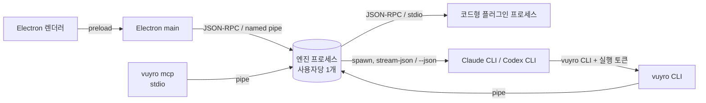

# 기술 스택 결정

> 기획자가 기술 결정을 Claude와 Codex에게 맡겼다(2026-10-23).
> **진행 방식**
> 1. 같은 브리프를 받고 두 엔지니어가 서로의 답을 보지 않은 채 각자 안을 냈다.
> 2. 두 안을 비교해서 갈린 항목만 2라운드에서 다시 논의했다.
> 3. 이견이 남지 않았다.
>
> 근거로 쓴 문서는 [[PRD]], [[n8n 노드 데이터 전달 분석]] §6, [[공유·권한·BlackBoard 설계]], [[Archon 분석]]이다.

## 0. 한눈에

| 영역 | 결정 |
|---|---|
| 앱 셸 | **Electron** |
| 엔진 | **strict TypeScript**, Electron과 분리된 **독립 Node 24 런타임**(버전 고정해서 함께 배포) |
| 프로세스 | 사용자당 **엔진 상주 프로세스 1개**. UI, `vuyro` CLI, MCP, 플러그인은 모두 클라이언트 |
| 통신 | **JSON-RPC 2.0(NDJSON) over Windows named pipe**. 파이프 접근 권한은 현재 사용자만으로 명시 |
| DB | **내장 `node:sqlite`**(WAL, 전용 worker). 이벤트 로그 + 조회 테이블 |
| 정의(템플릿·노드 타입 등) | **JSON 파일이 정본**. 기본 `%LOCALAPPDATA%\Vuyro\projects\<id>\definitions\`, 선택 시 저장소 안 `.vuyro/` |
| 에이전트 실행 | **CLI 직접 실행 + 구조화 이벤트 파싱**, 공급자별 어댑터 |
| UI | **React + Vite**, 그래프 **@xyflow/react**, 칸반 dnd-kit, Zustand + TanStack Query, Tailwind, Monaco |
| 스키마·표현식 | **Ajv(JSON Schema 2020-12)**, 표현식은 **자체 경로 문법 + 조건 JSON AST**(코드 실행 없음) |
| 플러그인 | 선언형은 엔진이 실행. 코드형은 **플러그인별 별도 Node 프로세스 + JSON-RPC** |
| MCP | **공식 TypeScript SDK, stdio**. 엔진 명령 API를 그대로 호출 |
| 파일 변경 감지 | 감시 + 읽기 전용 git/p4 조회로 **후보만 좁혀서 SHA-256** |
| 저장소·배포 | **pnpm workspaces**, esbuild/tsup, **electron-builder(NSIS) + electron-updater** |
| 테스트 | **Vitest**, 녹화한 CLI 출력을 재생하는 가짜 어댑터, 가상 시계 |

## 1. 앱 셸: Electron

- **이유**
  - 엔진, UI, CLI, 플러그인을 TypeScript 하나로 묶을 수 있다.
  - VSCode와 Obsidian이 같은 구조라서 PRD가 말하는 "외부 개발자가 플러그인을 만드는" 모델과 맞는다.
  - 그래프 캔버스, JSON 편집기(Monaco), 로그 뷰를 그대로 가져다 쓸 수 있다.
- **버린 대안**
  - Tauri: Rust와 JS 두 언어가 생기고, 결국 Node 사이드카가 필요하다. 이 PC에는 Rust도 없다.
  - .NET(WPF, WinUI, Avalonia): 그래프 편집기와 웹 기반 확장 UI를 위해 WebView 층을 따로 두게 된다.
- **위험과 대응**
  - 메모리 사용량과 설치 크기가 크다.
  - 렌더러에는 Node 권한을 주지 않는다(contextIsolation, preload만).
  - 실행 로그에 섞인 HTML은 안전하게 표시한다.

## 2. 엔진: TypeScript + 독립 Node 24

- 명령 계약, 노드 선언, 에이전트 어댑터, MCP를 한 타입 정의로 묶는다.
- **Electron 내장 Node를 쓰지 않는다(Codex 제안 채택).** 엔진이 Electron에 묶이면 헤드리스 `vuyro` CLI가 Electron 없이는 돌지 못하고, Electron을 업그레이드할 때 엔진도 흔들린다. 그래서 고정 버전의 Node 실행 파일을 함께 배포한다.
- Windows Job Object(자식 프로세스 묶음 종료) 같은 OS 기능은 필요해지면 작은 네이티브 보조 모듈로 처리한다.

## 3. 프로세스 구조와 통신



- **엔진이 상주한다.** UI를 닫아도 에이전트 실행, 공유 노드 대기열, 감시가 계속된다.
  - **기획 결정(2026-10-23): 창을 닫으면 앱은 트레이에 남고, 작업은 멈추지 않는다.** 트레이 메뉴에서 창 열기, 실행 중 작업 수 보기, 완전 종료를 할 수 있다. 완전 종료할 때 실행 중인 작업이 있으면 확인을 받는다.
  - 사용자별 단일 인스턴스 잠금을 둔다.
  - 시작할 때 이미 떠 있는 엔진의 소유권을 확인하고, 고아 프로세스를 정리한다.
- **named pipe를 쓰는 이유(Claude 제안, Codex 동의)**
  - TCP 포트를 열지 않는다. 그래서 브라우저발 공격(DNS rebinding, CSRF)과 토큰 파일 관리가 필요 없다.
  - 렌더러는 어차피 preload → main을 거치므로 HTTP의 이점이 없다.
  - 플러그인 RPC와 같은 프로토콜 하나로 통일된다.
  - 나중에 팀 동기화가 필요해지면 같은 핸들러를 HTTP/WebSocket에도 노출하면 된다.
- **조건(Codex):** Windows 파이프의 기본 보안 설정에는 Everyone이나 익명 계정의 읽기 권한이 들어갈 수 있다. 그래서 **현재 사용자 SID만 허용하는 보안 설정을 명시적으로 걸고, 테스트로 확인한다.**
  - **검증(M0):** 실제로 Everyone·Anonymous 읽기가 들어 있었다. Node API로는 바꿀 수 없어서 koffi(FFI)로 Win32 `SetSecurityInfo`를 불러 DACL을 현재 사용자 전용으로 바꾼다. 교체 전 짧은 구간에 들어온 연결은 끊는다. [[초기 검증 결과]] #1
- **명령 요청에 담는 것**
  - 요청 id: 재시도해도 한 번만 처리되게 한다.
  - 기대 revision: 동시 수정을 막는다.
  - 호출자 맥락: 주체, 티켓, 노드, 실행 토큰. 이걸로 AI 권한을 판정한다.
- **이벤트 구독:** 같은 파이프에서 notification으로 받는다. 이벤트마다 sequence 번호가 있어서, 연결이 끊겼다가 다시 붙으면 놓친 지점부터 이어 받는다.
- **노드 에이전트 식별:** 노드로 실행되는 에이전트는 환경 변수로 실행 토큰을 받는다. 그 토큰으로 `vuyro` CLI를 부르면 엔진이 "어느 노드의 에이전트인지"를 알고 권한을 판정한다(설계 문서 §2.2 `node.agent`).

## 4. 저장

- **DB: 내장 `node:sqlite`(DatabaseSync).**
  - 독립 Node를 고정 배포하므로 네이티브 모듈(better-sqlite3)의 빌드와 서명 부담이 없다. Node v24.16.0에서 플래그와 경고 없이 동작하는 것을 확인했다.
  - **조건(Codex):** 공식 안정성 등급이 아직 1.2(release candidate)이고 호출이 동기식이다. 그래서 DB 작업은 전용 worker에 두고, Node 버전을 올릴 때는 마이그레이션·복구 테스트를 통과해야 한다.
  - WAL 모드를 쓴다.
- **이벤트 로그**
  - append-only로 쌓는다. 이벤트마다 aggregate id, aggregate revision, 전역 sequence, 이벤트 스키마 버전, 주체를 넣는다.
  - 조회용 테이블은 이벤트를 추가하는 같은 트랜잭션 안에서 갱신하고, 언제든 이벤트를 재생해서 다시 만들 수 있다.
- **DB에 두는 것:** BlackBoard 값과 버전, 체크아웃 장부, 공유 노드 대기열, 실행 기록.
- **정의는 JSON 파일이 정본이다**(템플릿, 노드 타입, 스키마, 권한 프리셋, 공유 노드, BlackBoard 정의).
  - 파일 형식은 내보내기 봉투와 같다.
  - **기본 위치는 `%LOCALAPPDATA%\Vuyro\projects\<id>\definitions\`다.** `%APPDATA%`는 계정을 따라 다른 PC로 동기화되는 폴더라서 로컬 전용 앱에는 맞지 않는다는 Codex 지적을 받아들였다.
  - 사용자가 저장소 안 `.vuyro/`를 고를 때만 git이나 Perforce에 파일이 들어간다.
- **파일과 DB를 함께 고칠 때:** 둘 사이에는 트랜잭션이 없다. 그래서 다음 순서를 지킨다.
  1. 임시 파일에 쓴다.
  2. 원래 파일과 교체한다.
  3. DB에 활성 버전으로 등록한다.
  4. 엔진이 시작할 때 3단계까지 가지 못한 등록을 복구한다.
- 티켓은 시작할 때 쓰는 정의의 버전과 해시를 고정한다.

## 5. 에이전트 실행: CLI 직접 실행

| | Claude Code CLI | Codex CLI |
|---|---|---|
| 실행 | `claude -p --output-format stream-json --verbose` | `codex exec --json` |
| 이어하기 | `--resume <session>` (갈래 만들기 `--fork-session`) | `codex exec resume <session>` |
| 파일 수정 직전 훅 | `--settings`로 생성한 PreToolUse 훅 주입 | `hooks.PreToolUse`(`apply_patch`, `Bash`). 프로젝트 훅은 신뢰 확인이 필요 |
| MCP 연결 | `--mcp-config` | 설정 파일 |
| 비용 상한 | `--max-budget-usd` | 엔진이 토큰으로 감시 |
| 구조화 결과 | `--json-schema`(보조) | `--output-schema`(보조) |

- **어댑터가 공급자별 출력을 같은 이벤트로 바꾼다.** 이벤트 종류는 메시지, 도구 호출, 사용량, 세션 id, 결과, 최종 정착 상태다. 모르는 이벤트는 원본을 보존하고 건너뛴다.
- **노드 완료와 산출물 등록의 정본은 `vuyro` 명령 API다.** `--json-schema` 같은 구조화 출력은 결과 형식을 맞추는 보조 수단이다.
- **세션 재개는 "다음 턴으로 이어서"다.** 멈춘 도구 호출 지점부터 다시 시작하는 기능이 아니다. 그래서 재개 프롬프트에 멈출 때의 상태와 `pauseHash` 비교 결과를 넣는다(설계 문서 §3.8).
- **관측 단위는 토큰과 시간이다(기획 결정 2026-10-23).** 관측의 목적이 "어느 작업이 토큰을 얼마나 쓰고 어디서 병목이 생기는가"를 분석하는 것이기 때문이다.
  - 토큰은 입력, 캐시 입력, 출력을 나눠 수집한다.
  - Codex는 토큰만 표시하고, 추정 금액은 표시하지 않는다.
  - Claude는 CLI가 실제 금액을 주므로 보조 정보로만 함께 보여준다.
- **SDK와 `codex app-server`는 나중에 대체 어댑터로 붙인다.** app-server는 공개 문서가 있지만 0.163에서 아직 experimental 표시다. 대화형 제어가 중요한 에이전트 패널 단계에서 다시 검토한다.

## 6. UI

- React + Vite + TypeScript를 쓴다. 렌더러에는 Node 권한이 없다.
- 그래프 캔버스는 **@xyflow/react**다. 노드와 포트를 커스텀 컴포넌트로 만든다. 좌표는 템플릿 JSON에 두지만, 실행 의미는 엔진의 그래프 모델이 정한다.
- 칸반은 dnd-kit, 상태 관리는 Zustand + TanStack Query, 스타일은 Tailwind, JSON과 스키마 편집은 Monaco로 한다.
- **실행 이벤트가 많아도 느려지지 않게 한다.** 이벤트를 화면용 조회 상태로 모아서, 바뀐 노드만 다시 그린다.

## 7. 스키마와 표현식

- **Ajv의 JSON Schema 2020-12 전용 인스턴스**를 쓴다.
  - 봉투에 `$schema`를 명시한다.
  - 원격 `$ref`는 금지한다. 참조는 번들 내부로만 고정한다.
  - 기본 검증은 "선언한 필드는 검사하고, 추가 필드는 보존"이다. 엄격 모드는 노드마다 고른다.
- **표현식은 자체 경로 문법으로 파싱한다.** 예: `{{ input.summary }}`, `{{ nodes.<id>.artifacts.x }}`.
  - 노드는 id로 참조하고, 아이템은 lineage로 고른다.
  - 분기 조건은 정해진 비교·논리 연산만 JSON AST로 표현한다.
- **`eval`과 범용 JS 템플릿은 쓰지 않는다.** 가져온 JSON이 사실상 코드를 실행할 수 있게 되기 때문이다(n8n 표현식 샌드박스의 반복된 사고).

## 8. 플러그인

- **선언형 노드는 런타임이 없다.** 엔진의 내장 실행기(에이전트, 스크립트, 승인, 합류, 공유 노드 요청 등)가 JSON 정의를 해석해서 실행한다.
- **코드형 플러그인은 플러그인마다 별도 Node 프로세스에서 돈다.**
  - 프로세스는 플러그인마다 하나를 띄워 재사용한다.
  - 엔진과는 버전이 있는 NDJSON JSON-RPC로 통신한다.
  - manifest에 확장 종류(노드 실행기, 산출물 kind, 에이전트 어댑터, 작업 공간 어댑터)와 필요한 능력을 선언한다.
  - 엔진 명령, 파일, 자격증명은 선언한 능력을 통해서만 요청한다.
- **별도 프로세스는 보안 경계가 아니다.** 코드형 플러그인은 "사용자가 설치하고 신뢰한 코드"로 취급한다. 설치할 때 확인을 받고, 배포물 해시·API 버전·요청 능력을 기록한다.

## 9. MCP

- 공식 TypeScript SDK로 **stdio MCP 서버**(`vuyro mcp`)를 만든다. 구현할 때 현재 공식 패키지 이름을 확인해서 고정한다.
- MCP는 엔진 명령 API를 그대로 호출한다. DB를 직접 건드리지 않는다.
- 도구 스키마는 명령 카탈로그에서 생성한다. 다만 노출할 명령 목록은 따로 골라서 정한다.
- 호출할 때마다 호출자, 대상 티켓, 노드 맥락을 함께 넘기고, 엔진이 AI 권한 규칙(설계 문서 §2)으로 판정한다.

## 10. 파일 변경 감지 (내부 체크아웃 사후 검출)

- **후보를 좁힌다.**
  - 파일 감시(@parcel/watcher, Windows ReadDirectoryChangesW)를 쓴다.
  - git status, `p4 opened` 같은 **읽기 전용 조회**를 함께 쓴다. 외부 툴에 체크아웃을 걸지는 않는다(기획 결정).
  - Intermediate, Binaries, Saved, DerivedDataCache는 감시에서 뺀다. 감시할 경로는 프로젝트마다 설정한다.
- **판정은 후보 파일의 SHA-256으로 한다.** 크기와 수정 시각은 다시 해시할지 정하는 힌트로만 쓴다.
- 감시가 끊겼거나 엔진이 꺼져 있던 동안의 변경은 대상 경로를 다시 조사한다. 누가 바꿨는지 모르면 "귀속 불명 변경"으로 표시한다.

## 11. 저장소 구조와 배포

```
packages/
  contracts/       명령·이벤트·봉투·노드 선언 타입과 JSON Schema
  engine/          엔진(그래프, 실행, 권한, BlackBoard, 체크아웃, 공유 노드)
  agent-adapters/  claude, codex
  plugin-sdk/      플러그인 작성용 타입과 RPC 도우미
  cli/             vuyro
  mcp/             vuyro mcp
apps/
  desktop/         Electron main + preload + React UI
```

- import 방향은 contracts → engine → 호스트(cli, mcp, desktop)만 허용한다. 엔진은 Electron을 import하지 않는다. 이 규칙을 린트로 검사한다.
- pnpm workspaces로 시작하고, Turborepo나 Nx는 필요해질 때 붙인다.
- 번들은 esbuild/tsup으로 만든다.
- 설치 파일은 electron-builder NSIS로 만들고, 고정 버전 Node 런타임과 엔진을 함께 넣는다.
- **자동 업데이트는 electron-updater로 한다.** 업데이트할 때 엔진을 바로 교체하지 않는다. 순서는 다음과 같다.
  1. 새 작업을 받지 않는다.
  2. DB를 백업한다.
  3. 마이그레이션한다.
  4. 엔진을 재시작한다.

## 12. 테스트

- 테스트 도구는 Vitest다.
- **엔진 테스트는 실제 에이전트 CLI를 돌리지 않는다.**
  - 녹화해 둔 CLI 출력(JSONL)을 재생하는 가짜 어댑터를 쓴다.
  - 시계, 파일 시스템, 프로세스, 플러그인도 가짜로 바꿔 끼운다.
  - 이것으로 승인·반려 루프, 팬아웃·합류, 공유 노드 대기열과 멈춤, claim·체크아웃 충돌, 일시정지·재개, 크래시 후 이벤트 재생을 비용 없이 재현한다.
- **CLI 출력 파서는 계약 테스트로 확인한다.** 버전을 표시한 실제 출력 픽스처로 검사한다. 실제 CLI로 돌리는 스모크 테스트는 릴리스 전에 수동으로 한다.
- UI E2E(Playwright + Electron)는 MVP 이후에 붙인다.

## 13. 구현 초기에 확인할 것

결정은 끝났지만, 아래는 문서와 도움말로만 확인했다. 첫 구현 때 실제로 검증한다.

1. named pipe에 현재 사용자 전용 보안 설정을 걸 수 있는지, 다른 계정에서 접근이 막히는지
   → **M0 확인:** 걸 수 있다(koffi로 DACL 교체). 다른 계정 실접속 시험은 관리자 권한이 없어 못 했고, DACL에서 빠진 주체를 OS가 막는 것으로 대신 확인했다. [[초기 검증 결과]] #1
2. Codex `PreToolUse` 훅이 `apply_patch`를 실제로 막는지, Windows에서 `commandWindows`가 동작하는지
3. 이 PC에서 `codex exec --json`의 실제 이벤트 모양(thread id, usage)
4. Claude `stream-json`의 비용·토큰 필드와 `--settings` 훅 주입
5. worker 안에서 `node:sqlite`의 WAL 동작과 동시 읽기 성능
   → **M0 확인:** 문제 없다. 쓰기 worker 1개 + 읽기 전용 worker로 나누고, `synchronous=FULL`을 기본으로 한다. [[초기 검증 결과]] #5
6. Unreal 프로젝트 크기 폴더에서 @parcel/watcher의 이벤트 유실 여부

## 14. 논의 경과

| 항목 | Claude 1라운드 | Codex 1라운드 | 결과 |
|---|---|---|---|
| 셸·엔진 언어 | Electron + TS | 같음 | 합의 |
| 엔진 런타임 | Electron 내장 Node 재사용 | 독립 Node 배포 | **Codex 안** |
| 통신 | named pipe JSON-RPC | localhost HTTP + WebSocket | **Claude 안**(Codex 철회, ACL 조건 추가) |
| SQLite | better-sqlite3 | 미정(네이티브 모듈 위험 지적) | **`node:sqlite`**(2라운드, worker·버전 고정 조건) |
| 정의 위치 | `%APPDATA%` | 파일 정본(위치 미정) | **`%LOCALAPPDATA%`**(Codex 보완) |
| 해시 | xxh3 | 후보만 SHA-256 | **Codex 안** |
| 재개 판정 | baseHash 비교 | pauseHash 필요 | **Codex 안**(설계 문서 §3.8 수정) |
| 나머지(UI, Ajv, 플러그인, MCP, 배포, 테스트) | | | 거의 같음, 세부 조건을 서로 보완 |
