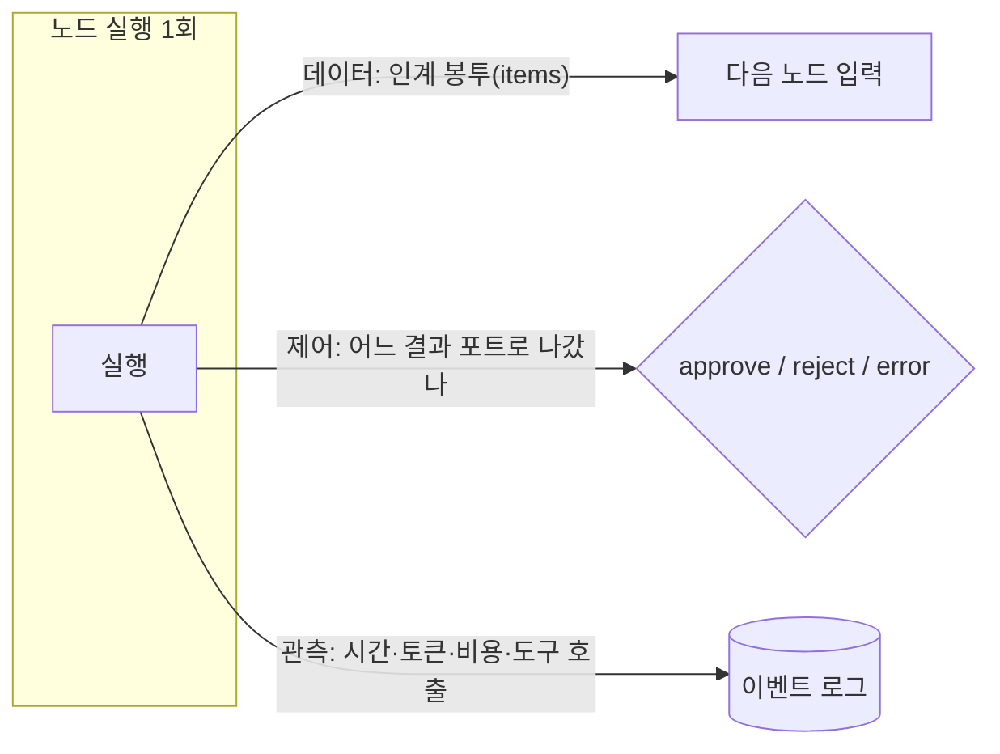
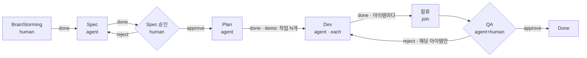

# n8n 노드 간 데이터 전달 분석 (Vuyro 인계 규격 설계용)

> **질문:** 노드가 결과를 다음 노드로 넘길 때 정보를 규격화하면 여러 형태의 노드를 만들 수 있지 않을까?
> n8n은 400개가 넘는 노드가 서로 연결되는데, 그게 가능한 이유가 **모든 노드가 같은 모양의 데이터를 주고받기 때문**이다. 이 문서는 그 규격을 소스에서 확인하고 Vuyro에 맞게 바꾼 초안을 제안한다.
> 소스(`master`, 위 커밋)의 `packages/workflow/src/interfaces.ts`와 `packages/core/src/execution-engine/`를 직접 읽었다. 코드는 실행하지 않았다. 링크는 맨 아래 [[#10. 참고 파일 링크]]에 있다.

## 0. 요약

- **n8n의 규격은 "아이템 배열" 하나다.** 모든 노드는 `{ json, binary?, pairedItem? }` 모양의 아이템 배열을 받고, 출력 포트마다 아이템 배열을 내보낸다. 노드 종류와 상관없이 이 모양은 같다.
- **포트에는 종류(connection type)가 있다.** 데이터가 흐르는 `main`과, AI 노드에 모델·메모리·도구·출력 파서를 꽂는 `ai_*` 포트가 따로 있다. 후자는 데이터가 아니라 **능력을 주입**하는 포트다.
- **어느 상위 노드든 이름으로 참조할 수 있다.** 바로 앞 노드뿐 아니라 `$('Spec').item.json.title`처럼 몇 단계 위 노드의 출력을 읽는다. 이때 `pairedItem`(아이템 계보)으로 "이 아이템은 저 노드의 몇 번째 아이템에서 나왔다"를 추적한다.
- **실행 기록은 노드 × 실행 횟수로 쌓인다.** `runData[노드이름][runIndex]`에 입력 출처, 시작 시각, 소요 시간, 상태, 출력이 남는다. 루프를 돌면 runIndex가 늘어난다.
- **스키마는 기본적으로 런타임 추론이다.** 실행 결과에서 스키마를 뽑아 UI에서 드래그로 매핑하게 한다. 최근에는 노드 버전별 출력 JSON Schema 파일(`__schema__/vX/output.json`)을 두기 시작했다.
- **Vuyro에 맞게 바꿀 점:** 노드가 거칠고(기획, 스펙, 구현) 오래 걸리며, 산출물이 툴 밖에 있고, 결과가 승인/반려로 갈린다. 그래서 n8n 규격을 그대로 쓰지 않고 **데이터(인계 봉투) · 제어(결과 포트) · 관측(실행 기록)** 세 채널로 나눈다. 초안은 [[#6. Vuyro 인계 규격 초안]].

## 1. 아이템: 노드 사이를 오가는 단위

### 1.1 아이템 하나의 모양 (`INodeExecutionData`)

```ts
interface INodeExecutionData {
  json: IDataObject;                     // 본체. 아무 JSON 객체
  binary?: { [key: string]: IBinaryData };// 파일. 키 이름으로 여러 개
  pairedItem?: IPairedItemData | IPairedItemData[] | number; // 계보
  error?: NodeApiError | NodeOperationError; // 에러 출력 포트로 갈 때
  metadata?: { subExecution: RelatedExecution }; // 서브 워크플로 실행 링크
  redaction?: ...;                       // 민감 데이터 가림 표시
  sendMessage?: ChatNodeMessage;         // 채팅 트리거로 시작한 경우 사용자에게 메시지
}
```

- `json`이 사실상 전부다. 노드마다 다른 것은 **`json` 안의 필드 이름뿐**이다.
- `binary`는 파일을 담는다. 원래는 base64를 그대로 넣었지만, 지금은 `IBinaryData.id`로 파일시스템이나 S3에 저장한 것을 **참조**할 수 있다(`data`, `mimeType`, `fileName`, `fileSize`, `fileType: 'text' | 'json' | 'image' | 'pdf' | ...`).
- 아이템 단위로 에러를 실을 수 있어서, 10개 중 2개만 실패한 경우를 표현한다.

### 1.2 노드 출력 = 포트별 아이템 배열 (`NodeOutput`)

```ts
type NodeOutput = INodeExecutionData[][] | EngineRequest | null;
//                 ↑ [출력포트 인덱스][아이템 인덱스]
```

- 바깥 배열이 **출력 포트**다. IF 노드는 `outputs: [main, main]`, `outputNames: ['true', 'false']`로 포트 두 개를 선언하고, 조건에 맞는 아이템을 각 포트 배열에 나눠 담는다.
- **분기 = 어느 포트에 아이템을 넣었느냐**다. 별도의 "분기 결정" 필드가 없다. 빈 포트에 연결된 하위 노드는 실행되지 않는다.
- `null`을 반환하면 "성공했지만 데이터 없음"이고, 그 분기는 거기서 끝난다.
- `EngineRequest`는 새로 생긴 경로다. 노드가 "이 노드를 이 입력으로 실행해서 결과를 돌려 달라"고 엔진에 요청하고, 결과(`ITaskData`)를 받아 이어서 실행한다. AI 에이전트가 도구 노드를 부를 때 쓴다.

### 1.3 노드는 아이템 배열 전체를 받는다

- `execute()`는 `this.getInputData(inputIndex)`로 입력 포트별 배열 전체를 받는다. 보통 노드 안에서 `for (i of items)` 루프를 돈다.
- 파라미터의 표현식은 **아이템마다** 다시 계산된다(`getNodeParameter(name, itemIndex)`). 그래서 "아이템 5개가 들어오면 HTTP 요청 5번"이 기본 동작이다.
- 한 번만 돌게 하려면 노드 설정 `executeOnce`를 켠다. 엔진이 첫 아이템만 넘긴다.
- Code 노드는 이것을 모드로 드러낸다: `runOnceForAllItems` / `runOnceForEachItem`.

## 2. 포트와 연결

### 2.1 연결 정의 (워크플로 JSON)

```jsonc
"connections": {
  "IF": {                       // 출발 노드 "이름"
    "main": [                   // 출발 포트 종류
      [ { "node": "Send Mail", "type": "main", "index": 0 } ],  // 출력 0번(true)
      [ { "node": "Log",       "type": "main", "index": 0 } ]   // 출력 1번(false)
    ]
  }
}
```

- 연결은 `(출발 노드, 포트 종류, 출력 번호) → (도착 노드, 포트 종류, 입력 번호)`다.
- **노드를 이름으로 가리킨다.** id도 있지만 연결과 표현식은 이름 기준이라, 이름을 바꾸면 에디터가 참조를 모두 고쳐 써야 한다.

### 2.2 포트 종류 (`NodeConnectionTypes`)

| 종류 | 용도 |
|---|---|
| `main` | 일반 데이터 흐름. 아이템 배열이 흐른다 |
| `ai_languageModel`, `ai_memory`, `ai_tool`, `ai_outputParser`, `ai_retriever`, `ai_embedding`, `ai_vectorStore`, `ai_document`, `ai_textSplitter`, `ai_reranker`, `ai_agent`, `ai_chain` | AI 루트 노드(에이전트, 체인)에 **하위 노드(sub-node)를 꽂는 포트**. 데이터가 아니라 객체(모델, 도구 등)를 공급한다(`supplyData()`) |

- 포트는 `INodeInputConfiguration { type, displayName, required, maxConnections, filter }`로 선언한다. 예를 들어 Agent 노드는 Chat Model 포트를 `required: true, maxConnections: 1`로, Tool 포트는 개수 제한 없이 선언한다.
- **입출력 포트 목록이 파라미터에 따라 바뀔 수 있다.** `inputs`에 표현식을 쓸 수 있어서, Agent는 "출력 파서 사용"을 켜면 Output Parser 포트가 생기고, Merge는 `numberInputs: 3`이면 입력이 3개가 된다.

### 2.3 여러 입력 합류

- 입력이 여럿인 노드는 엔진이 `waitingExecution`에 입력을 모아 두었다가 실행한다.
- Merge v3는 모드로 합치는 방법을 고른다: `append`, `combineByFields`, `combineByPosition`, `combineAll`, `combineBySql`, `chooseBranch`.
- 노드 타입이 `requiredInputs`로 "몇 번 입력이 꼭 와야 실행하는지"를 선언할 수 있다.

## 3. 노드 타입 선언 (`INodeTypeDescription`)

```ts
{
  displayName, name, group, description,
  version: number | number[],            // 노드 타입 버전. 워크플로는 typeVersion을 고정
  defaults: { name, color },
  inputs:  Array<'main' | INodeInputConfiguration> | 표현식,
  outputs: Array<'main' | INodeOutputConfiguration> | 표현식,
  outputNames?: string[],                // ['true', 'false'] 등
  properties: INodeProperties[],         // 파라미터 → UI 폼 자동 생성
  credentials?: [...],
  sensitiveOutputFields?: string[],      // 항상 가려야 할 출력 경로
}
```

- **노드 = 선언(description) + 실행 함수(execute)** 다. 화면의 파라미터 폼, 포트 개수, 아이콘이 모두 선언에서 나온다. 외부 개발자가 커뮤니티 노드를 만드는 계약이 이것이다.
- **노드 타입에 버전이 있다.** 워크플로의 각 노드는 `typeVersion`을 기록하므로 노드 동작을 바꿔도 예전 워크플로는 예전 버전으로 돈다. (Vuyro의 "티켓 시작 시 템플릿 버전 고정"과 같은 생각을 노드 타입 단위에도 적용한 것.)
- **출력 스키마 파일:** `__schema__/v3.1.0/output.json`처럼 노드 버전별 출력 JSON Schema를 두기 시작했다. AI Agent는 기본 출력이 `{ output: string }`이고, 출력 파서를 붙이면 `{ output: object }`다(`output.with-parser.json`). 설명에 "문자열이다, 객체로 감싸지 마라" 같은 규칙을 써서 AI 빌더가 읽게 한다.

## 4. 상위 노드 참조와 아이템 계보

### 4.1 표현식

| 표현식 | 뜻 |
|---|---|
| `{{ $json.title }}` | 지금 처리 중인 입력 아이템의 필드 |
| `{{ $input.first() / last() / all() }}` | 입력 포트의 아이템들 |
| `{{ $('Spec').item.json.title }}` | Spec 노드 출력 중 **지금 아이템과 이어진** 아이템 |
| `{{ $('Spec').first().json }}`, `.all()`, `.itemMatching(i)` | Spec 노드 출력의 특정 아이템 |
| `{{ $binary.file.fileName }}` | 바이너리 메타 |
| `$execution`, `$workflow`, `$vars`, `$env`, `$now` | 실행·워크플로·환경 정보 |

- UI는 실행 결과를 **Schema / Table / JSON** 세 가지로 보여주고, Schema 뷰의 필드를 파라미터 칸으로 끌어다 놓으면 표현식이 만들어진다. 비개발자가 표현식 문법을 몰라도 연결할 수 있는 핵심 장치다.

### 4.2 `pairedItem` (아이템 계보)

```ts
interface IPairedItemData { item: number; input?: number; sourceOverwrite?: ISourceData }
```

- 출력 아이템마다 "입력 몇 번 포트의 몇 번째 아이템에서 나왔는가"를 기록한다. `$('Spec').item`은 이 사슬을 거슬러 올라가서 짝이 맞는 아이템을 찾는다.
- 노드가 직접 넣지 않으면 엔진이 `assignPairedItems`로 채운다(입력이 1개면 전부 0번, 개수가 같으면 같은 순번).
- **사슬이 끊기면 표현식이 에러**다("Paired item data unavailable" 계열). Code 노드에서 아이템을 새로 만들면서 계보를 안 넣는 경우가 대표적이다. n8n 사용자가 가장 자주 부딪히는 문제 중 하나다.

## 5. 실행 기록과 실행 제어

### 5.1 `runData` (노드 × 실행 횟수)

```ts
runData: { [nodeName: string]: ITaskData[] }   // 배열 인덱스 = runIndex

interface ITaskData {
  startTime: number; executionIndex: number; executionTime: number;
  executionStatus?: 'new' | 'running' | 'success' | 'error' | 'waiting' | 'canceled' | 'crashed' | 'unknown';
  source: Array<{ previousNode, previousNodeOutput?, previousNodeRun? } | null>; // 입력 포트별 출처
  data?: { main: INodeExecutionData[][] };   // 출력
  inputOverride?: ...;                        // 입력을 덮어쓴 경우
  error?: ExecutionError;
  metadata?: { subExecution?, subRun?, ... };
}
```

- **입력을 따로 저장하지 않고 `source`(어느 노드의 몇 번 출력, 몇 번째 실행에서 왔나)만 남긴다.** 입력은 상위 노드의 출력을 가리키는 포인터로 복원한다.
- 루프를 돌면 같은 노드에 runIndex 0, 1, 2…가 쌓인다. 표현식에서 `$('Node').all(branchIndex, runIndex)`로 특정 회차를 읽을 수 있다.
- 토큰이나 비용은 이 구조에 없다. AI 하위 노드의 사용량은 그 하위 노드 출력 안에 들어간다.

### 5.2 빈 출력과 에러

| 설정 | 동작 |
|---|---|
| (기본) | 아이템 0개를 내면 그 분기가 조용히 끝난다 |
| `alwaysOutputData` | 0개면 빈 아이템 하나를 만들어 하위 노드가 돌게 한다 |
| `onError: 'stopWorkflow'` | 실패하면 워크플로 중단(기본) |
| `onError: 'continueRegularOutput'` | 에러를 아이템에 담아 정상 포트로 보낸다 |
| `onError: 'continueErrorOutput'` | **에러 전용 출력 포트**가 생기고 실패한 아이템이 그리로 간다 |
| `retryOnFail`, `maxTries`, `waitBetweenTries` | 재시도 |

### 5.3 고정 데이터와 부분 실행

- **Pin data:** 노드 출력을 고정해 두면(`pinData[노드이름] = 아이템[]`) 실행할 때 그 노드를 돌리지 않고 고정값을 쓴다. 하위 노드를 만들 때 비싼 상위 노드(API, LLM)를 매번 돌리지 않으려고 쓴다.
- **부분 실행:** 노드 하나를 다시 돌리면 `findStartNodes`가 "더러운(dirty)" 노드부터 시작점을 찾는다. dirty 조건은 "에러가 있음" 또는 "실행 기록도 pin data도 없음"이다. 소스 주석을 보면 "파라미터가 바뀜", "상위 노드가 꺼짐"은 아직 `TODO`다. 즉 **n8n은 상위가 바뀌어도 하위를 Stale로 만들지 않는다.** Vuyro가 차별화할 지점이 그대로 남아 있다.

### 5.4 사람 개입

- Wait 노드가 실행을 `waiting` 상태로 멈추고, `timeInterval` / `specificTime` / `webhook` / `form` 중 하나로 재개한다. 재개 요청의 내용(폼 응답 등)이 그 노드의 출력 아이템이 된다.
- Slack, Gmail 등의 "Send and Wait for Response" 작업도 같은 구조다. **사람의 응답이 다른 노드 출력과 똑같은 아이템으로 흐른다.** 사람 노드를 특별 취급하지 않는 점이 핵심이다.

## 6. Vuyro 인계 규격 초안

### 6.1 n8n과 Vuyro는 노드의 성격이 다르다

| | n8n | Vuyro |
|---|---|---|
| 노드 크기 | 작다(HTTP 요청 1번, 필드 변환 1번) | 크다(스펙 작성, 구현, QA) |
| 실행 시간 | 밀리초~초 | 분~일. 사람 대기가 포함됨 |
| 데이터 | JSON과 파일이 아이템 안에 들어있음 | 산출물이 툴 밖에 있음(git, Perforce, Confluence). **위치와 버전만** 넘김 |
| 아이템 수 | 수십~수천 개가 일상 | 대부분 1개. 계획을 작업 N개로 나눌 때만 여러 개 |
| 분기 | 데이터 조건(IF) | 사람·에이전트의 판정(승인/반려) |
| 다음 소비자 | 다음 노드의 파라미터 | **다음 에이전트의 프롬프트와 사람의 검토 화면** |
| 상위 변경 | 무시(dirty만 봄) | Stale 전파가 핵심 기능 |

그래서 n8n에서 **아이템 배열, 포트, 계보, 노드 선언, 실행 기록 구조**는 가져오고, 데이터 내용은 Vuyro 노드에 맞게 바꾼다.

### 6.2 세 채널로 나눈다



1. **데이터 채널(인계 봉투):** 다음 노드가 읽는 것. 스키마로 검증한다.
2. **제어 채널(결과 포트):** 어느 간선으로 갈지. n8n처럼 "아이템을 어느 포트에 넣었나"로 표현한다.
3. **관측 채널(실행 기록):** 시간, 토큰, 비용, 도구 호출, 세션 id. **하위 노드로 넘기지 않는다.** 이벤트 로그에 남기고 화면과 통계에서만 쓴다(PRD 설계 원칙 "상태는 이벤트로 기록").

### 6.3 인계 봉투

```ts
// 노드 실행 1회의 결과. n8n ITaskData.data에 해당
interface NodeRunOutput {
  schemaVersion: 1;
  port: string;              // 나간 결과 포트: 'done' | 'approve' | 'reject' | 'error' ...
  items: HandoffItem[];      // 보통 1개. 팬아웃이면 N개
}

// n8n INodeExecutionData에 해당
interface HandoffItem {
  data: Record<string, unknown>;          // json. 노드 타입·포트가 선언한 스키마로 검증
  artifacts?: Record<string, ArtifactRef>; // binary 대신. 내용이 아니라 위치+버전
  summary?: string;                        // 사람과 다음 에이전트가 읽는 요약(마크다운)
  lineage?: ItemRef[];                     // pairedItem 대신. 어느 노드의 몇 회차 몇 번째 아이템에서 왔나
}

interface ArtifactRef {
  kind: 'file' | 'git' | 'p4' | 'confluence' | 'jira' | 'url' | string; // 플러그인이 kind 추가
  uri: string;               // 경로, 저장소+경로, 페이지 id 등
  version?: string;          // git sha, p4 CL 번호, Confluence 버전
  title?: string;
  mimeType?: string;
  contentHash?: string;      // Stale 판정용
}

interface ItemRef { nodeId: string; run: number; item: number }
```

- **`summary`를 규격에 넣는 이유:** Vuyro에서 다음 소비자는 대부분 LLM과 사람이다. 산출물 전체를 다시 읽지 않아도 되도록 노드가 "무엇을 했고 무엇이 남았는지"를 짧게 넘긴다. 승인 화면에서도 이걸 먼저 보여준다(Archon `ApprovalContext`와 같은 역할).
- **`artifacts`는 이름 있는 슬롯이다.** `specDoc`, `plan`, `change`처럼 노드 타입이 슬롯 이름과 허용 kind를 선언한다. 그래야 "Spec 노드의 specDoc"을 안정적으로 가리킬 수 있다.
- **에이전트는 이 봉투를 CLI로 제출한다.** `vuyro node done --port approve --data @out.json`, `vuyro artifact add specDoc confluence://...`. 엔진이 스키마로 검증하고, 틀리면 거부 메시지를 돌려줘서 에이전트가 고치게 한다. 화면 버튼(사람 승인)도 같은 명령을 쓴다.

### 6.4 노드 타입 선언

```ts
interface NodeTypeSpec {
  type: string;              // 'vuyro.agent', 'vuyro.approval', 'p4.sync' (플러그인 네임스페이스)
  version: number;           // n8n typeVersion처럼 템플릿이 고정
  completion: 'human' | 'agent' | 'join' | 'script';
  inputs:  PortSpec[];
  outputs: PortSpec[];       // 결과 포트. 파라미터에 따라 달라질 수 있음
  attachments?: AttachmentSpec[]; // n8n ai_* 포트에 해당: agentAdapter, skill, rule, mcp
  params: ParamSpec[];       // UI 폼 자동 생성
}

interface PortSpec {
  name: string; label: string;
  schema?: JSONSchema;                         // data 스키마
  artifacts?: { slot: string; kinds: string[]; required?: boolean }[];
  mode?: 'whole' | 'each';                     // 입력 전용. each = 아이템마다 1회 실행(팬아웃)
  required?: boolean;
}
```

- **`attachments`는 n8n의 `ai_*` 포트를 빌린 것이다.** 에이전트 노드에 "어떤 CLI로 돌릴지(Claude/Codex)", "스킬", "규칙", "MCP 서버"를 꽂는다. 데이터가 아니라 능력이다. 플러그인이 에이전트 어댑터를 추가하면 이 포트에 꽂을 수 있는 노드가 하나 늘어나는 구조가 된다.
- **`mode: 'each'`가 병렬 Dev를 만든다.** Plan이 작업 N개를 아이템 N개로 내면, `each` 입력을 가진 Dev 노드가 아이템마다 1번씩 돈다. 합류 노드가 다시 `whole`로 모은다.

### 6.5 참조 문법

- **노드는 이름이 아니라 id로 가리킨다.** 화면에는 이름을 보여주고, 저장은 id로 한다. n8n의 "이름 바꾸면 참조 재작성" 문제를 피한다.
- 형식 예시: `{{ input.summary }}`, `{{ nodes.spec.artifacts.specDoc }}`, `{{ nodes.plan.item.data.scope }}`(계보로 짝 찾기), `{{ nodes.qa.runs.last.data.feedback }}`.
- 기획자는 문법을 쓰지 않는다. n8n Schema 뷰처럼 **상위 노드의 선언된 스키마를 트리로 보여주고 끌어다 놓게** 한다. 실행 전에도 선언 스키마가 있으므로 트리가 비지 않는다(n8n은 실행 전이면 비어 있다).
- 에이전트 노드의 프롬프트 템플릿에 기본으로 "직접 입력의 summary + 산출물 목록"을 넣어 두면, 대부분의 노드는 참조를 하나도 안 써도 동작한다.

### 6.6 기본 템플릿에 적용하면



| 노드 | 나가는 포트 | data | artifacts |
|---|---|---|---|
| Spec | `done` | `{ title, acceptanceCriteria[] }` | `specDoc: confluence` |
| Spec 승인 | `approve` / `reject` | `{ comment }` | - |
| Plan | `done` | 아이템 N개, 각 `{ taskId, scope, files[] }` | `plan: file` |
| Dev (each) | `done` / `error` | `{ taskId, notes }` | `change: git \| p4` |
| QA | `approve` / `reject` | `{ verdict, feedback, failedTaskIds[] }` | `report: file` |

- **반려는 계보로 범위를 좁힌다.** QA가 `failedTaskIds`로 3번 작업만 반려하면, 엔진이 lineage를 따라 Dev의 3번 아이템만 다시 돌린다. n8n의 `pairedItem`이 Vuyro에서는 "어디까지 다시 할지"를 정하는 데 쓰인다.
- **Stale은 "읽은 것 기록"으로 판정한다.** 노드 실행 1회마다 실제로 읽은 상위 출력(`nodeId, run, artifact version/hash`)을 기록한다(n8n `source` + Archon 출력 스냅샷 비교). Spec이 다시 열려 `specDoc` 버전이 바뀌면, 이전 버전을 읽은 하위 실행이 Stale 후보가 된다. 사람이 확정한다.

### 6.7 커스텀 원칙 누구나 노드와 스키마를 만든다 (결정 2026-10-23)

> **결정:** 노드 타입과 스키마는 **사람도 에이전트도** 만들고 고칠 수 있어야 한다. 항상 커스텀할 수 있다는 전제로 설계한다. 기본으로 제공하는 노드도 사용자가 만드는 노드와 같은 방식으로 만들고, 특별 취급하지 않는다.

**노드 타입을 만드는 세 가지 방법** (코드가 필요 없는 것부터)

| 방법 | 만드는 것 | 주로 누가 | 예 |
|---|---|---|---|
| 선언형 | `NodeTypeSpec`(JSON) + 프롬프트 템플릿 또는 실행할 명령 | 기획자(UI 편집기), 에이전트(CLI, MCP) | "스펙 리뷰 에이전트", "p4 sync 스크립트" |
| 묶음형 | 워크플로 일부(서브그래프)를 노드 하나로 감쌈 | 개발자, 에이전트 | "Spec 작성 + 승인" 묶음 |
| 코드형 | 플러그인 패키지(실행 함수 포함) | 개발자 | 외부 서비스 연동, 새 완료 방식 |

- 기본 노드(Agent, 승인, 합류, 스크립트)도 선언형으로 만든다. 그래서 사용자는 기본 노드를 복제해서 고쳐 쓸 수 있다.
- 노드 타입을 만들고 고치는 일도 같은 명령 API를 거친다(`vuyro nodetype create/update`, 에이전트 패널, MCP). 사람이 만든 것과 에이전트가 만든 것이 같은 작업 기록에 남는다.

**스키마를 만드는 방법**

- **사람:** 필드 편집기에서 만든다(문자열, 숫자, 참/거짓, 목록, 객체, 산출물 슬롯). 저장 형식은 JSON Schema다. 고급 사용자는 JSON Schema를 직접 고칠 수 있다.
- **에이전트:** 세 가지 방법이 있다.
  - JSON Schema를 직접 쓴다.
  - 출력 예시를 받아 스키마를 추론한다(n8n Schema 뷰의 추론을 작성 도구로 쓰는 셈).
  - 대화로 고친다. 예: "QA 결과에 심각도 필드 추가해줘."
- **어느 쪽이 만들든 결과는 같은 JSON Schema다.** 사람이 만든 것을 에이전트가 고치고, 에이전트가 만든 것을 편집기에서 다시 열 수 있다. 편집기가 표현하지 못하는 키워드는 지우지 않고 보존하며 "고급"으로 표시한다.

**세 층에서 커스텀할 수 있다**

1. **노드 타입:** 기본 스키마, 포트, 파라미터.
2. **템플릿의 노드 인스턴스:** 타입을 새로 만들지 않고 필드를 추가하거나 설명을 고친다(타입 스키마를 확장).
3. **티켓 실행 중:** 스키마 자체는 바꾸지 않는다(템플릿 버전 고정). 에이전트가 선언에 없는 필드를 내면 그대로 받아 두고 "선언되지 않은 필드"로 표시한다. 사람이 버튼 하나로 템플릿에 반영한다.

**아무리 고쳐도 규격이 깨지지 않게 하는 장치**

- **봉투의 바깥 모양은 고정이다.** `port, items, data, artifacts, summary, lineage`는 바꿀 수 없다. 커스텀할 수 있는 것은 `data` 스키마, 산출물 슬롯, 포트 목록, 파라미터다. 그래서 누가 만든 노드든 다른 노드와 연결된다.
- **저장할 때마다 새 버전이 된다.** 실행 중인 티켓은 고정된 버전으로 돌기 때문에, 에이전트가 스키마를 바꿔도 진행 중인 작업에는 영향이 없다.
- **저장할 때 검사한다.** 하위 노드가 참조하는 필드나 포트가 사라지면 경고한다(Archon `validate`와 같은 역할).
- **검증 강도:** 기본은 "선언한 필드는 검증하고, 추가 필드는 허용"이다. 엄격 모드는 노드마다 고른다.

### 6.8 권한이 필요한 산출물 가져오기 (결정 2026-10-23)

> **결정:** 두 방법을 모두 지원하고, 템플릿에서 노드마다 고른다.

| 방법 | 동작 | 맞는 경우 |
|---|---|---|
| A. 에이전트가 직접 | 엔진은 `ArtifactRef`만 넘긴다. 에이전트가 `attachments`로 받은 MCP나 CLI(예: Confluence MCP, p4 CLI)로 직접 읽는다 | 일부만 읽거나 둘러봐야 할 때. 에이전트의 권한으로 충분할 때 |
| B. 가져오기 노드 | 앞에 가져오기 노드를 둔다. 원격 `ArtifactRef`를 로컬 `file` `ArtifactRef`(원본 version, contentHash 포함)로 바꿔서 넘긴다 | 여러 노드가 같은 내용을 읽을 때. 스크립트 노드처럼 에이전트가 없는 노드가 읽어야 할 때. 무엇을 가져왔는지 확실히 남겨야 할 때 |

- **두 방법이 같은 부품을 쓴다.** kind 플러그인(`confluence`, `p4` 등)이 두 가지를 선언한다.
  - `fetch(ref)`: 내용을 로컬 파일로 가져온다. 가져오기 노드가 쓴다.
  - `describeAccess(ref)`: 에이전트에게 "이 산출물은 어떤 도구나 명령으로 읽는지"를 알려주는 안내문. 방법 A에서 프롬프트에 붙는다.
- **가져오기 노드는 범용으로 하나 둔다.** kind 플러그인을 골라 쓰므로 kind마다 노드를 따로 만들 필요가 없다. 물론 6.7의 방식으로 전용 가져오기 노드를 따로 만들 수도 있다.
- **어느 방법이든 실제로 읽은 version을 "읽은 것 기록"에 남긴다.** 그래야 Stale 판정이 같은 방식으로 동작한다.
  - 방법 B는 엔진이 직접 기록한다.
  - 방법 A는 에이전트의 도구 호출 로그(stream-json)에서 페이지 id나 CL 번호를 뽑아낸다. 뽑아낼 수 없는 경우를 대비해 에이전트가 직접 보고하는 명령(`vuyro artifact used <slot> --version <v>`)도 둔다.

## 7. 차용 우선순위

### A. 규격 설계에 바로 반영

| # | n8n에서 가져올 것 | Vuyro에서의 형태 |
|---|---|---|
| N1 | 모든 노드가 같은 모양의 아이템 배열을 주고받음 | `NodeRunOutput { port, items[] }` 하나로 통일 |
| N2 | 분기 = 어느 출력 포트에 아이템을 넣었나 | 결과 포트(approve/reject/error). 별도 분기 필드 없음 |
| N3 | 노드 = 선언 + 실행 함수, 선언에서 UI 폼과 포트가 나옴 | `NodeTypeSpec`. 플러그인 계약의 중심. 코드 없는 선언형 노드도 같은 계약(§6.7) |
| N4 | 노드 타입 버전(`typeVersion`) | 템플릿이 노드 타입 버전까지 고정 |
| N5 | 실행 기록 = 노드 × runIndex, 입력은 `source` 포인터로 | 반려 루프 회차와 Stale 판정의 기반 |
| N6 | 아이템 계보(`pairedItem`) | `lineage`. 부분 반려와 Stale 범위 계산에 사용 |

### B. 구현 단계에서 참고

| # | 내용 | 메모 |
|---|---|---|
| N7 | `ai_*` 하위 노드 포트(능력 주입) | `attachments`. 에이전트 어댑터, 스킬, 규칙, MCP |
| N8 | 파라미터에 따라 바뀌는 포트 | QA 노드의 판정 종류, 합류 노드의 입력 개수 |
| N9 | Schema 뷰 드래그 매핑 | 선언 스키마 기반이라 실행 전에도 보임 |
| N10 | `onError: continueErrorOutput` | 모든 노드에 `error` 포트를 선택적으로 노출 |
| N11 | Pin data | 템플릿 편집 시 상위 출력 고정. Archon `--stubs`와 같은 용도 |
| N12 | 출력 스키마 파일에 LLM용 설명 적기 | 에이전트에게 "이 필드는 이렇게 채워라"를 스키마 description으로 전달 |

### C. 나중에

| # | 내용 |
|---|---|
| N13 | `EngineRequest`: 노드가 엔진에 다른 노드 실행을 요청하고 결과를 받음. 에이전트가 툴의 다른 노드(예: p4 sync 스크립트)를 도구처럼 부르는 데 쓸 수 있다 |
| N14 | `sensitiveOutputFields` / redaction: 출력에서 항상 가릴 경로 선언 |
| N15 | Merge의 합치기 모드들. Vuyro 합류 노드는 처음엔 `append`만 |

## 8. 따라 하지 말 것

| n8n의 문제 | Vuyro의 대응 |
|---|---|
| 노드를 이름으로 참조해서 이름 변경 시 재작성 필요 | id로 저장, 이름은 표시용 |
| 스키마가 런타임 추론이라 실행 전엔 매핑 UI가 비어 있고 검증이 없음 | 포트에 스키마 선언 필수(Archon A7과 같은 결론). 추론은 미리보기 보조로만 |
| 아이템 단위 실행이 기본이라 "한 번만"을 따로 켜야 함 | 기본은 `whole`(1회), 팬아웃만 `each`로 명시 |
| 계보가 끊기면 표현식이 에러 | 엔진이 lineage를 항상 채우고, 노드가 직접 쓰는 경우만 검증 |
| 0개 출력이면 분기가 조용히 끝남 | 노드는 반드시 포트 하나로 끝난다. 할 일 없음도 `skipped` 같은 명시 포트로 |
| 파일을 아이템 안에 넣음(원래 base64) | 산출물은 항상 참조(`ArtifactRef`) |
| 상위 변경을 하위에 전파하지 않음(dirty 판정 TODO) | 읽은 것 기록 + 버전/해시 비교로 Stale 전파 |

## 9. 열린 질문

1. **아이템이 정말 필요한가?** 팬아웃(병렬 Dev)이 유일한 사용처라면 `items[]` 대신 "단일 봉투 + 팬아웃 전용 노드"가 더 단순할 수 있다. 다만 n8n 규격을 따르면 부분 반려와 계보를 같은 구조로 처리할 수 있다. → 현재 제안은 `items[]` 유지.
2. ~~스키마 선언 방식~~ → **결정(2026-10-23):** 저장 형식은 JSON Schema 하나다. 사람은 필드 편집기나 직접 편집으로, 에이전트는 직접 작성, 예시에서 추론, 대화로 만든다. 노드 타입도 누구나 만든다. [[#6.7 커스텀 원칙 누구나 노드와 스키마를 만든다 (결정 2026-10-23)|§6.7]]
3. **`summary`를 누가 쓰나:** 에이전트가 직접 쓰게 할지, 노드가 끝난 뒤 별도 요약 단계를 돌릴지(비용 증가).
4. ~~권한이 필요한 산출물~~ → **결정(2026-10-23):** 에이전트가 직접 가져오는 방법과 가져오기 노드를 둘 다 지원하고, 노드마다 고른다. [[#6.8 권한이 필요한 산출물 가져오기 (결정 2026-10-23)|§6.8]]
5. **스키마 버전 관리:** 노드 타입 버전이 오르면서 출력 스키마가 바뀌면, 고정된 템플릿의 하위 참조를 어떻게 이전할지.
6. **에이전트가 만든 노드 타입의 공유:** 내 컴퓨터에서 쓰는 것은 자유롭게 두더라도, 팀에 공유하거나 기본 템플릿에 넣을 때는 사람 검토를 거치게 할지.
7. **가져오기 노드의 자격증명:** 에이전트 CLI나 MCP가 이미 가진 인증을 빌려 쓸지, kind 플러그인이 OS 자격증명 저장소를 쓰게 할지. Vuyro가 비밀번호나 토큰을 직접 저장하지 않는 것을 기본으로 한다.

## 10. 참고 파일 링크

기준 커밋: `79ba1af7ebba27bd07252854f87acb0abbb91e3f`

| 주제 | 파일 |
|---|---|
| 아이템, 포트, 노드 선언, 실행 기록 타입 | [packages/workflow/src/interfaces.ts](https://github.com/n8n-io/n8n/blob/79ba1af7ebba27bd07252854f87acb0abbb91e3f/packages/workflow/src/interfaces.ts) (`INodeExecutionData` 1910행, `NodeConnectionTypes` 3064행, `INodeTypeDescription` 3198행, `ITaskData` 3698행) |
| 실행 상태 목록 | [packages/workflow/src/execution-status.ts](https://github.com/n8n-io/n8n/blob/79ba1af7ebba27bd07252854f87acb0abbb91e3f/packages/workflow/src/execution-status.ts) |
| 표현식 프록시(`$json`, `$('Node')`, 계보 추적) | [packages/workflow/src/workflow-data-proxy.ts](https://github.com/n8n-io/n8n/blob/79ba1af7ebba27bd07252854f87acb0abbb91e3f/packages/workflow/src/workflow-data-proxy.ts) |
| 실행 엔진(합류 대기, executeOnce, alwaysOutputData, 에러 포트, 계보 자동 채움) | [packages/core/src/execution-engine/workflow-execute.ts](https://github.com/n8n-io/n8n/blob/79ba1af7ebba27bd07252854f87acb0abbb91e3f/packages/core/src/execution-engine/workflow-execute.ts) |
| 부분 실행과 dirty 판정 | [partial-execution-utils/find-start-nodes.ts](https://github.com/n8n-io/n8n/blob/79ba1af7ebba27bd07252854f87acb0abbb91e3f/packages/core/src/execution-engine/partial-execution-utils/find-start-nodes.ts) |
| IF(출력 포트 2개) | [nodes-base/nodes/If/V2/IfV2.node.ts](https://github.com/n8n-io/n8n/blob/79ba1af7ebba27bd07252854f87acb0abbb91e3f/packages/nodes-base/nodes/If/V2/IfV2.node.ts) |
| Merge(입력 개수가 파라미터로 바뀜) | [nodes-base/nodes/Merge/v3/actions/versionDescription.ts](https://github.com/n8n-io/n8n/blob/79ba1af7ebba27bd07252854f87acb0abbb91e3f/packages/nodes-base/nodes/Merge/v3/actions/versionDescription.ts) |
| Wait(사람 개입, 재개 방식) | [nodes-base/nodes/Wait/Wait.node.ts](https://github.com/n8n-io/n8n/blob/79ba1af7ebba27bd07252854f87acb0abbb91e3f/packages/nodes-base/nodes/Wait/Wait.node.ts) |
| AI Agent 입력 포트 구성 | [nodes-langchain/nodes/agents/Agent/utils.ts](https://github.com/n8n-io/n8n/blob/79ba1af7ebba27bd07252854f87acb0abbb91e3f/packages/@n8n/nodes-langchain/nodes/agents/Agent/utils.ts) |
| AI Agent 출력 스키마 | [Agent/__schema__/v3.1.0/](https://github.com/n8n-io/n8n/tree/79ba1af7ebba27bd07252854f87acb0abbb91e3f/packages/@n8n/nodes-langchain/nodes/agents/Agent/__schema__/v3.1.0) |

## 관련 문서

- [[PRD]] · [[Archon 분석]](§4.3 출력 전달, §11 A7 typed 출력 계약, B4 Stale 판정)
